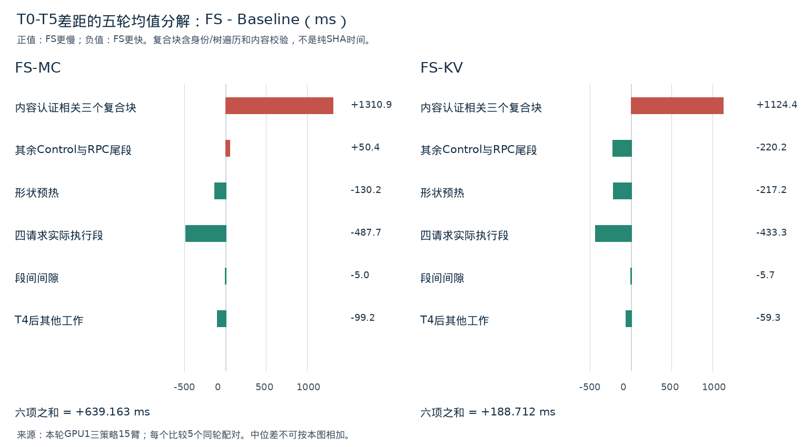

# 剩余差距优先需要验证Serving测量路径

**最终裁决：VALIDATE_SERVING_PATH。**

现有记录已能定位主要正向成本到内容认证相关复合块，而非在线求解或原生驱逐。正常Serving的必要控制成本仍未被独立测出；应先验证共同的消费者最小化Serving路径，再决定是否继续优化底层Runtime。此判定不授权删除任何SHA或Postcheck。

## 核心发现

- FlowState相对Marconi的T0–T5配对中位差为 **+775.819 ms**，相对KVFlow为 **+134.442 ms**。只使用最新`three_policy/serving`五轮15臂，排除Smoke及新旧路径配对；不混用失败批量实验或Legacy数据。
- 内容认证相关三个复合块的**配对均值合计**分别多 **1310.913 ms / 1124.398 ms**，被请求执行收益、预热及其他成本抵消。这里不是纯SHA计时，也不能拿它们直接从中位差中扣除。
- 三策略每次受保护FA内容为 **480 / 128 / 190 MiB**。同一代码、同一预算不等于相同审计字节量；FlowState恢复前沿更深，未被四请求重算覆盖的原FA区域更大。
- 找到一个具体待验证对象：`admission_baseline`完整内容摘要中，当前链路真正被后续读取的是`selected_components`；其额外内容SHA/FA-map主要留在证据中，另有实验性“两次audit”计数门禁。不能仅凭未消费就删掉整个baseline，必须保留身份核验并先证明等价。

## 1. 数据与计时口径

输入来自`control_path_separation_20261101`最终报告、两份CSV和`arms/t{1..5}_{fs,mc,kv}/run/{summary,reconciliation,post_request}.json`。15/15 PASS、每策略5次；源SHA与冻结清单交叉核验，全部原始控制/请求输出仍未改。每臂4个串行Pending，Qwen3.5-9B、SGLang v0.5.17、GPU1 H100 PCIe TP=1、n=16、K=3。 原始日志完成行与摘要核对一致；日志包含被SGLang忽略的可选多模态TorchCodec/FFmpeg导入traceback，均在Engine就绪前，未据此删样本或把启动成本归到T0–T5。详见validation.json。

逐臂精确恒等式（相邻区间，无重叠）：

`T5−T0 = Control + RPC尾段 + Σ形状预热Wall + Σ请求Wall + 段间间隙 + (T5−T4)`。

四请求执行段之和使用各请求`end_ns−start_ns`，不是ΣTTFT，也不是包含请求间隙的`request_exec_total_ms`。T5不包含summary写盘、Engine清理、初始重放或本次离线分析。详见原[计时边界](../control_path_separation_20261101/measurement_boundaries.md)。

Control内八个`timing`段顺序执行；`clock.stages`只有六段，其间隙已经含FA基线和协调。Selection Call是Selection阶段的子项；Adapter调用是Reconciliation子项；SHA是Observation/Freshness/FA-post/cache_state内部工作。下表带“子项”者不可再加到父项上。

## 2. 各策略阶段耗时与同轮差（ms）

每格为五轮中位数；配对差先逐轮相减后取中位，不能用前三列相减替代。完整均值/范围和每轮数据见CSV。

|阶段|FS|Marconi|KVFlow|ΔFS−MC|ΔFS−KV|
|---|---:|---:|---:|---:|---:|
|Control（父区间）|8031.346|7588.912|7816.041|+406.329|+250.360|
|　完整观察（含两次Recurrent内容读取）|2427.774|2468.314|2501.650|-25.311|-46.751|
|　物理/逻辑候选映射|0.571|0.570|0.592|+0.003|-0.007|
|　Strict Epoch认证|148.179|147.506|153.060|+0.323|+0.183|
|　策略选择整体|31.686|35.146|37.792|-2.284|-5.482|
|　　选择内核调用【子项】|16.065|2.025|4.228|+14.119|+11.823|
|　Freshness＋Bind/Preflight复合段|1259.721|1251.274|1281.571|-2.275|-11.614|
|　FA索引与完整内容基线|985.667|970.710|980.095|-10.940|+5.572|
|　Reconciliation（含Postcheck）|892.402|885.863|914.510|+11.515|-5.848|
|　　13次Adapter调用【子项，非纯Native kernel】|16.066|16.857|17.353|-0.908|-1.091|
|　　协调其余时间【子项，未拆】|876.336|869.006|897.157|+12.284|-4.757|
|　FA完整后验＋保护区基线|1528.349|1067.386|1147.843|+434.155|+389.765|
|　窗内Journal序列化|50.945|50.318|52.243|+0.423|-0.425|
|　Control其余未拆|721.810|715.941|737.564|-5.234|-8.728|
|RPC尾段（父区间）|2808.637|2354.943|2371.979|+436.163|+355.159|
|　Journal出窗序列化|201.378|186.817|198.730|+6.530|+2.649|
|　Journal写入/flush/fsync|201.088|200.783|196.002|-6.706|+2.176|
|　admission baseline完整cache_state|788.729|353.427|401.465|+434.021|+392.224|
|　完整响应编码/压缩/SHA/Base64|508.416|493.983|510.994|+12.412|-5.316|
|　客户端解码校验|564.966|589.930|556.111|-51.769|+11.327|
|　尾段其余未拆|512.723|519.407|510.266|-0.963|-5.311|
|四请求形状预热|7334.262|7439.105|7382.325|-35.120|-174.192|
|四请求实际执行段|780.247|1277.499|1227.209|-479.384|-421.536|
|段间间隙|8.691|14.137|14.371|-4.940|-5.723|
|T0–T4（父区间）|19027.521|18520.140|19226.674|+507.381|-36.025|
|T4–T5（父区间）|2371.961|2020.744|2074.294|+313.647|+283.023|
|　请求后cache_state完整审计|831.718|374.327|439.062|+453.915|+386.097|
|　重复缩进报告展示|1305.147|1287.781|1269.852|+28.536|-27.200|
|　冻结Oracle核验|0.111|0.124|0.118|-0.006|-0.010|
|　请求后其余未拆|290.289|379.195|373.710|-98.957|-82.427|
|T0–T5（父区间）|21366.763|20529.374|21300.968|+775.819|+134.442|

说明：13次Adapter调用中位合计仅约16–17 ms，Reconciliation其余约0.87–0.90 s包含29次物理观察、重复绑定/校验、账本构建等；不能把余量全部称为Postcheck。Recurrent SHA没有独立计时，不能把Observation/Freshness整体当SHA。

在线选择内核FS比MC/KV分别多14.119/11.823 ms，但包含元数据读取、finish/validate等操作的选择整体反而分别短2.284/5.482 ms；没有证据把776/134 ms差距归于求解器。

## 3. 776 ms与134 ms如何形成

### 逐轮可加总一级分解

差值均为FS−Baseline，单位ms；六个中间列之和逐行等于T0–T5差。

**FS-MC**

|轮次|Control|RPC尾段|预热|请求段|间隙|T4–T5|T0–T4|T0–T5|
|---|---:|---:|---:|---:|---:|---:|---:|---:|
|1|+436.490|+496.295|-35.120|-485.409|-4.940|+432.095|+407.315|+839.410|
|2|+279.001|+436.163|+275.266|-476.059|-6.990|+213.645|+507.381|+721.027|
|3|+406.329|+646.679|-27.523|-479.384|-1.762|+313.647|+544.339|+857.987|
|4|+346.815|+315.508|-758.722|-537.986|-2.340|+638.298|-636.725|+1.573|
|5|+836.422|+420.120|-104.842|-459.565|-8.984|+92.669|+683.150|+775.819|

**FS-KV**

|轮次|Control|RPC尾段|预热|请求段|间隙|T4–T5|T0–T4|T0–T5|
|---|---:|---:|---:|---:|---:|---:|---:|---:|
|1|+375.437|+355.159|-128.824|-455.505|-4.197|+830.684|+142.071|+972.754|
|2|+250.360|+308.814|-348.632|-421.536|-8.246|+283.023|-219.239|+63.784|
|3|-709.325|+460.914|+147.291|-478.154|-3.835|-17.214|-583.110|-600.324|
|4|+213.260|+351.519|-174.192|-420.147|-6.464|+408.929|-36.025|+372.904|
|5|+481.332|+601.020|-581.747|-390.909|-5.723|+30.470|+103.973|+134.442|

两个T0–T5中位差都来自第5轮：MC为`683.150 + 92.669 = 775.819 ms`；KV为`103.973 + 30.470 = 134.442 ms`。这是同轮恒等式，不是把若干独立中位数拼在一起。

**KVFlow符号反转：** T0–T4中位差−36.025来自第4轮，该轮T4–T5多408.929 ms，故同轮T0–T5为+372.904 ms。第2轮也由−219.239翻为+63.784 ms。不能把不同轮次的−36.025和+134.442相减，宣称“审计阶段实测170.467 ms”。

### 可加总的均值归因

为解释总体来源，以下使用同五轮配对**均值**，不是中位数：

|相邻、不重叠的贡献组|FS−MC均值|FS−KV均值|
|---|---:|---:|
|内容认证相关三个复合块|+1310.913|+1124.398|
|其余Control与RPC尾段|+50.361|-220.237|
|形状预热|-130.188|-217.221|
|四请求实际执行段|-487.681|-433.250|
|段间间隙|-5.003|-5.693|
|T4后其他工作|-99.238|-59.285|
|合计T0–T5|+639.163|+188.712|

内容认证相关三块分别为：

|复合块|FS−MC均值|FS−KV均值|
|---|---:|---:|
|FA后验＋保护区基线|+444.614|+368.189|
|admission baseline|+428.989|+389.746|
|请求后完整cache_state|+437.309|+366.463|

因此不是“所有控制步骤都比Baseline慢”：物理映射、Epoch认证、Adapter释放及协调主体差值小；正差集中在上述三个内容认证相关块。它们包含树遍历/身份操作和SHA，不能按字节数或阶段名把整块都归为纯SHA。

KV第3轮完整观察出现大差值：FS相对KV快880.691 ms，使五轮Control均值差122.213小于中位差250.360。原始日志无独立CPU/PCIe争用指标，成因UNKNOWN；该轮仍完整保留，不当作无效样本删除。

## 4. 为什么相同校验代码会产生不同认证成本

|策略|受保护FA索引数|每次保护内容|请求后FA条目数|请求后节点数|
|---|---:|---:|---:|---:|
|FlowState|15,360|480 MiB|23,552|26|
|Marconi|4,096|128 MiB|37,888|29|
|KVFlow|6,080|190 MiB|35,904|29|

每策略五轮这些工作量完全相同。`control.py:346–356`将四请求预计重算区间取并集，再保护其余原始FA索引；FS较深的E使更多旧FA不被重算，因而需要认证更大的保护区。相同保护区分别在Control末、admission baseline、请求后cache_state处理三次。按记录字节数与代码调用次数计算，FS分别比MC/KV多处理1056/870 MiB保护FA内容；这是**处理量推导，非耗时或带宽实测**。

反向因素也存在：FS请求后FA条目和节点更少，CPU树/FA映射工作可能更少。请求后未拆残差配对均值分别为−98.474/−81.225 ms；不能把所有请求后差异都归为SHA或JSON。

## 5. A/B/C分类与实际消费者

A=正常执行/安全语义必须保持；B=当前合同需要或当前实现承担安全职责，可研究等价优化；C=实验认证/取证目的。类别表示职责，不表示可直接关闭。

|操作|分类|当前消费者与限制|
|---|---|---|
|Scope、FA前沿、候选/Token兼容、物理映射、引用/别名/槽位闭包|A|planner.prepare、bind/preflight、Native Match；不能缩小视图后忽略候选外状态|
|Epoch/计划验证、实际在线选择|A；重复编码/校验实现属B|决定合法S及T/E/G/J；复用需证明输入不可变和失效条件|
|Recurrent-only释放、必要前后验|A；全树观察组织属B|StrictReconciler逐驱逐与Adapter本地检查；没有版本覆盖证明不能删29次观察|
|Recurrent内容SHA|B（含C认证职责）|初始前后、Apply前、所选状态驱逐前后及请求后比较；缺少等价内容保护证明，不能删除|
|完整FA前后SHA及保护区基线|B（含C认证职责）|控制require验证FA未改；保护区摘要由请求后gate使用；不能整块视为离线工作|
|admission baseline的selected_components|A/B|runner.py:369–371用于请求后存储切片身份比较，应保留该字段及必要当前身份验证|
|admission baseline的selected_payload/fa_map/fa_protected_payload|C目的，改造需B等价门禁|本冻结链路没有后续读取这些嵌套字段作比较；它们被存档，另有两次audit计数门禁。不能据此删整个baseline或弱化身份检查|
|请求后完整cache_state、Cold/Oracle和大体积报告|C目的、当前认证合同中的B|决定实验能否PASS，不能删除后仍宣称同等级恢复认证|
|Journal、完整响应、fsync|C为主，当前请求前证据持久化要求属B|没有参与评分，但错误必须处理；不能直接关fsync后称同协议|
|响应编码/校验与传输|B，完整树/轨迹体量主要C|当前保存完整证据；网络/持久化未独立计时，不是纯通信时间|
|形状预热|C测量准备|避免请求窗口新编译，但本Full内实际执行；不是稳态Serving每Epoch必要工作，也不能后验扣除|

关键新发现来自消费者追踪，不能依据`bridge.py:52`“A类”注释判定整个cache_state为Serving必须。当前runner唯一读取`admission_baseline`嵌套值的位置是`selected_components`；实际内容比较读取的是`control.selected_payload_after`和`control.fa_protected_payload`。这使“消费者投影后的baseline”值得验证，但本报告没有证明删掉全部baseline仍等价。

## 6. 无法归因的项目与最小缺失证据

|项目|现有可知|尚不可知/所需最小计时|
|---|---|---|
|Observation/Freshness中的Recurrent SHA|复合段Wall，实际保留内容读取|单独GPU同步/D2H/CPU SHA；按payload调用前后加CPU/Wall并区分同步|
|Bind、Preflight、每次Postcheck|Freshness整体与Reconciliation整体，13次Adapter计时|各自CPU、29次observe、校验与账本的分段|
|FA-post|整个复合段、保护字节量|完整FA hash、保护区hash、FA-map与集合构建各自时间|
|RPC尾段|Journal、baseline、pack和decode单独Wall|server外层JSON、socket/排队、response.raw/json fsync各自时间|
|T4–T5残差|post cache_state、展示、Oracle可独立扣除后的残差|post RPC传输/持久化、post_request JSON、正确性门禁/额外记录各自时间|
|Serving必要下限|当前混合认证控制时间|无消费者最小化Serving的独立正确性与实测证据，不能通过减去SHA估算|

Control未拆残差每策略中位约0.72 s，RPC尾段未拆约0.51 s；这些是**按不重叠已测区间计算的残差**，不是新增实测子阶段。它们的配对差很小或为负，当前不足以取代已定位认证块成为主要正差解释；但不能把其中工作随意归为可删。

## 7. 五个问题的结论与唯一下一步

1. **相对Marconi约776 ms：** 中位所在R5的Full差683.150 ms加Post差92.669 ms精确得到。五轮均值归因中，三个认证相关复合块多1310.913 ms，抵消四请求约487.681 ms执行收益及其他负差后，净均值639.163 ms；不是多花约776 ms在求解。
2. **相对KVFlow约134 ms：** 中位所在R5由103.973+30.470 ms组成。五轮均值认证相关多1124.398 ms，被请求约433.250 ms、预热约217.221 ms和其他负差抵消，净均值188.712 ms。
3. **−36转+134：** 两个中位数来自不同轮。真实同轮反转见R4和R2表；不能做中位数差的加法归因。
4. **必要还是取证：** 选择、真实释放及必要元数据安全不表现为数百毫秒正差主因；正差集中在带内容认证的复合块与T3后/请求后审计。现阶段仍不能剥离纯SHA时间，不能将全部计时认作正常Serving成本或可删开销。
5. **是否继续：** 足以优先选择VALIDATE_SERVING_PATH，不足以直接选一个底层Runtime热点做性能优化，也不足以证明去掉取证后的FS必然获胜。

**唯一建议动作：** 单独审查并验证三策略共用的“按实际消费者投影的Serving控制接口”，优先针对admission baseline保留当前selected组件身份和A类门禁，明确未消费摘要/大响应的证据去向；保留独立完整Validation参照。只有身份新鲜度、Slot复用/ABA边界、错误处理与Native/Cold认证等价后，才值得授权同协议Serving计时。必要时同时补上上表的最小叶子时间戳；不需要先重写Solver或继续调整复制粒度。**本次没有执行该动作，也没有从现有结果事后删项计算Serving净收益。**

范围限制：同一受控快照五轮、共享CPU/另一GPU有任务；没有生产P95或显著性证明。跨Workflow物理血缘仍PROVENANCE_UNVERIFIED。无生产代码修改、GPU启动、成本重拟合或参数搜索。

## 8. 证据索引

- [逐臂分解](per_arm_attribution.csv)、[逐轮配对](paired_attribution.csv)、[配对中位/均值/范围](paired_summary.csv)、[均值图数据](mean_additive_components.csv)、[来源SHA清单](source_manifest.json)。
- 原始路径模板：`evaluation/control_path_separation_20261101/arms/t{1..5}_{fs,mc,kv}/run/summary.json`（边界/Journal/pack/decode/展示）、`reconciliation.json`（八阶段、baseline绝对时间、13操作、保护区字节）、`post_request.json`（trace.audit[1].ns与请求后状态）。逐臂CSV保留完整路径。
- 中位所在轮：[t5_fs summary](../control_path_separation_20261101/arms/t5_fs/run/summary.json)、[t5_mc](../control_path_separation_20261101/arms/t5_mc/run/summary.json)、[t5_kv](../control_path_separation_20261101/arms/t5_kv/run/summary.json)。反转R4：[t4_fs](../control_path_separation_20261101/arms/t4_fs/run/summary.json)、[t4_kv](../control_path_separation_20261101/arms/t4_kv/run/summary.json)。
- 源码消费者：control.py:290–312、330–375；bridge.py:51–99、209–235；runner.py:174–183、291–299、369–380、480–490；codec.py:17–33；flowstate/strict_control.py:203–221。均为只读核查。
- [可复算提取脚本](analyze.py)、[报告/图生成脚本](build_report.py)。输入目录只读；派生文件仅写入本审计独立目录。
