# FlowState 完整实验手册

整理日期：2026-10-10。范围为已存在的正式实验、辅助实验及审查；本手册不提出新的论文结构，不修改论文。本轮只读取、归档、汇总及重绘已有数值，不运行GPU、引擎、replay、策略或新测试。

## 阅读约定与证据级别

- **RECORDED**：参数、顺序或事件能在既有config、plan、raw、日志或记录中定位。报告汇总已注明来源，并不意味着原报告的每条推论都重新得到证明。
- **RECONSTRUCTED_FROM_CODE**：从脚本恢复操作逻辑，但没有找到完整shell历史或该步骤的逐事件日志；不能冒充日志证明实际执行。
- **UNKNOWN**：现有证据不能唯一确定；**MISSING**：在对应artifact内没有找到所需独立文件。
- **DESIGN_ONLY / CPU_AUDIT**：设计或只读审计，不是新GPU性能结果。
- 原始路径完整索引见[experiment_evidence_paths.md](experiment_evidence_paths.md)；全部文件存在性索引见artifact_inventory.csv。已读取输入摘要见source_integrity.json。目录被索引不表示其中所有日志逐行通过认证。
- 所有指标区分 modeled ms、服务端TTFT、客户端TTFT、内部resume时间与客户端完整epoch。跨批次不合并；失效/失败记录不进入正式均值，但在本手册保留。

本手册引用的SGLang正式版本为0.5.17，记录的构建提交为29481685462732237d80d86076d6563e1f658102。实验容器内`/model`、`/workspace`、`/repo`不直接等于宿主机路径。当前源码用来解释操作，历史运行结果以对应冻结配置及记录为准。

## 实验1：Hybrid Executable-State Correctness

### 1.1 名称、研究问题与原始假设

本组验证“attention侧有缓存”是否足以执行，以及仅移除recurrent checkpoint后是否回退至更浅可执行前沿。核心量为H/T（规划或实际匹配的attention前沿）、E（最深兼容且有效的recurrent前沿）、G=T−E。目标是证实组件独立控制与实际执行语义，不是比较策略速度。

### 1.2 环境与规模

Qwen3.5-9B，单H100 PCIe，TP=1，SGLang0.5.17，extra_buffer、tracking interval256、关闭overlap与CUDA graph、HiCache关闭。实际运行日志确认走UnifiedRadixCache+FULL/MAMBA组件；不能因旧类名含HiMamba就声称这些实验启用了hierarchical缓存。

早期gap验证：context45056、pool16、mem_fraction_static0.40、chunked_prefill45056。OpenHands causal gate：context131200、pool28、四个workflow各三请求，共12请求、15次census。SOTA正确性：context45056、pool24，16个snapshot、288个候选、800个逻辑continuation检查与69个E2E等价类请求。它们不是同一批样本。

### 1.3 设计与实际执行

**RECORDED，早期gap验证：**先构造16K浅checkpoint，再执行32K前缀；追加独特后缀使深节点成为internal；24个filler在16-slot池中触发原生容量驱逐，保持浅checkpoint活跃。被测R2重用同前缀；R3观察恢复后的新checkpoint。`server_full.log`中的match_end/extend/dup_free/forced_track与driver_results.json共同确认路径。

**RECORDED，直接组件干预：**WP3A每arm独立flush/rebuild；保留组驱逐off-path decoy，删除组驱逐target，两侧各释放一个49.125MiB逻辑slot，配平管理操作。把目标internalize以避免普通叶驱逐的FA级联。后续实际请求走原生COW/恢复与必要replay，未实现主机备份加载或任意tensor恢复。

**RECONSTRUCTED_FROM_CODE，adapter路径：**`flowstate/adapters/sglang.py:99`的evict_mamba_only先验证handle、runtime能力、精确token路径/节点及状态；`:332`校验目标；`:400`起拒绝device/host/session引用；存在host副本也拒绝。`:416`只调用MAMBA组件detach/LRU移除及component-aware free，不调用通用cascade；`:492`检查后置条件。scheduler空闲由调用方transport保证，adapter本身不能证明全局空闲。批量操作不是原子性证明。

FA preservation核对的是FULL路径/全树索引摘要、节点结构、allocator计数与非目标状态前后不变，不是逐字节校验全部KV tensor内容。恢复请求本身可能重算并替换gap内重复FA行，必须与“干预不修改FA”区分。可执行恢复依靠保留浅state与原生请求执行，不是从已free的slot恢复原内容。

### 1.4 主要结果

| 记录 | H | E | G | 实际EXTEND | 结果 |
|---|---:|---:|---:|---:|---|
| R2，原生压力后 | 32767 | 16384 | 16383 | 16384 | PASS；含1个新token |
| R3，R2恢复后探测 | 32767 | 32704 | 63 | 64 | PASS；chunk对齐后自愈 |
| R2插入重复释放 | — | — | — | — | 16320旧FA行作为duplicate释放，尾部63行差异有日志解释 |

| 正确性组 | 结果 | 证据范围 |
|---|---|---|
| 早期gap四项断言 | 4/4 PASS | H>E、gap走EXTEND、重复KV释放、checkpoint自愈 |
| OpenHands recurrent-only causal gate | PASS，12请求 | D2后仅驱逐B2/D2，保留A2/C2；FA preserved、无native容量污染、无OOM/截断 |
| SOTA snapshot检查 | 16/16 PASS | 800逻辑continuation、288候选；E/G与驻留不匹配均0 |
| SOTA实际等价类请求 | 69/69 PASS | frontier/gap误差0；其latency仅正确性诊断 |
| OpenHands多轮门禁 | MULTI_ROUND_RUNTIME_READY | 7条完成run，pool28、K2、三轮；非大规模性能实验 |
| RQ4正式GPU门禁 | 216生命周期、864请求通过 | 详见实验6；不能外推任意并发/故障语义 |

WP3A的局部因果数据：fork-parent保留/移除TTFT中位38.332/1507.858 ms，5对平均新增1472.748 ms，t区间[1464.412,1481.084]；NORMAL对照40.318/39.330 ms，平均差−0.670 ms，区间[−1.104,−0.236]。NORMAL没有新增replay，但未定义等价界，不能宣称时延统计等价。

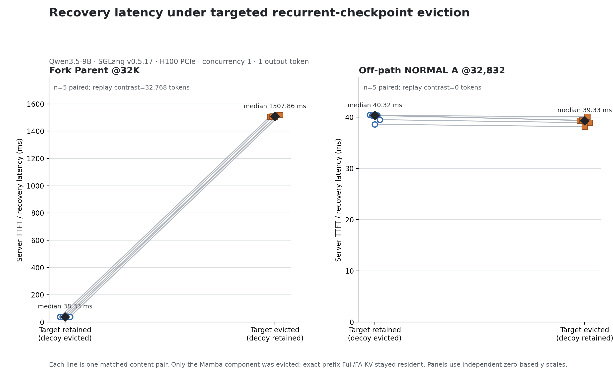

图为既有WP3A原图；横轴为fork/normal干预条件，纵轴为该受控请求的服务端时延。其64个fresh tokens与WP2的1个fresh token不同。

### 1.5 观察、支持范围与异常

支持限定空闲时点下的组件隔离和可执行gap语义。native容量驱逐在早期验证中是有意机制，在后期策略实验中则被视为污染，两者门禁不同。不能把通过这些案例解释成active/session/transfer、slot别名、跨rank事务与任意部署模式都已证明安全。状态完整性需要conv和temporal共同保留；Qwen普通slot的真实布局见实验9。

### 1.6 来源

源目录01_semantics/01_direct/01_gate/01_sota见路径索引。核心文件：`motivation/artifacts/runtime_validation_gap_replay_20260819/{driver.py,driver_results.json,server_full.log,instrumentation.patch,findings.md}`；WP3A同目录的raw/analysis与原图；`evaluation/openhands_recurrent_only_causal_gate.py`与其config、evictions.jsonl、census.jsonl、requests.jsonl；`evaluation/sota_runtime_correctness.py`及snapshot_cases.jsonl/e2e_cases.jsonl。未找到独立SOTA config.json，其引擎配置实际嵌在summary.json中，不能误报为配置完全缺失。旧测试PASS只引用冻结日志，本轮未重跑。

## 实验2：Recovery Cost Characterization

### 2.1 名称、问题与假设

在FA驻留保持不变时增加recurrent gap，检验真实恢复代价；再检验相同gap在不同target位置是否等价。Qwen测量用于建模基础；Kimi仅验证跨架构存在可测成本，不拟合通用模型。

### 2.2 环境

| 子实验 | 模型/硬件 | context与pool | 条件与重复 |
|---|---|---|---|
| WP2固定32K | Qwen3.5-9B、单H100、TP1、0.5.17 | 45056，16槽 | 6 gaps×5有效测量=30 |
| 128K长gap | 同上 | 131200，24槽；chunk45056 | 9条件×(2预热+12测量)=126 |
| 位置矩阵 | 同上 | 131200，24槽 | 4个T×5个G×14=280；另legacy70 |
| Kimi Phase3 | Kimi-Linear-48B-A3B-Instruct，2×H100 PCIe，TP2 | 32K上下文；其逐run engine_args为准 | 5 paired repetitions、每条件新engine，共10 |

均为extra_buffer、关闭overlap/CUDA graph、单令牌输出；Kimi用Triton attention/KDA后端。Qwen服务端TTFT、Kimi内部resume墙钟不是同一个指标，不能直接比较数值高低。

### 2.3 输入与执行过程

**WP2，RECORDED：**固定可缓存前缀F=32768，prompt=F+1个新token；每个trial flush并重建浅/深checkpoint。filler压力只移除深recurrent，保持FA hit=F；保留浅位置B=F−G。G为0/1024/4096/8192/16384/32768。每个repetition六条件共享内容、不同repetition使用不同内容；随机基序列五次循环移位。gate、冷shape及不平衡pilot保留但不计入30次正式统计。计时为TokenizerManager建立请求状态到收到并处理首输出的server-internal TTFT，含cache match/COW/replay/采样/同步，不含此前HTTP解析，也不是纯kernel。

**128K与位置矩阵，配置及raw确认：**构造精确H/E/G并检查实际匹配；使用正式recurrent-only primitive释放干预目标，保持FA。128K的9个gap覆盖0至131072。位置矩阵T=32768/65536/98304/131072，各G=0/4096/8192/16384/32768。按seed20260826平衡轮转；每条件2预热与12测量。`MeasuredPhi(T,G)=mean TTFT(T,G)−mean TTFT(T,0)`，相同T扣自己的基线，不能用一个32K基线扣所有T。流程细节可由`recovery_profiler_128k.py`、`recovery_position_audit.py`重建，逐trial身份/正确性由raw CSV确认。

**Kimi，RECORDED：**相同history、请求与runtime参数，AB/BA/AB/BA/AB顺序。A=H/E/G 16K/16K/0，B=16K/8K/8K；两条件先共同清除10K/12K/14K的中间KDA，只保留目标8K/16K层级；B再移除16K KDA。MLA全树驻留与公共KDA摘要一致。计时从scheduler首次真实prefix match到单令牌恢复请求结束，取两rank较大值，含共同256-token后缀；不含启动、历史物化、控制观测/逐出和网络传输。CUDA前向时间另存，不能与墙钟相加。准备阶段不允许重物化，恢复请求内重新物化缺失state是被测行为。

### 2.4 全部主要数值

#### Qwen固定32K正式结果

| G（tokens） | 有效重复 | TTFT均值（ms） | 中位数 | P25 | P75 | 请求完成中位数 |
|---|---|---|---|---|---|---|
| 0 | 5 | 32.49538359232247 | 32.37372194416821 | 32.19802584499121 | 33.043486066162586 | 32.37761999480426 |
| 1024 | 5 | 64.45438782684505 | 64.17678203433752 | 64.0900069847703 | 64.7639730013907 | 64.18024399317801 |
| 4096 | 5 | 210.8380279969424 | 211.10267797484994 | 210.71364101953804 | 211.21406205929816 | 211.10617299564183 |
| 8192 | 5 | 411.1935766413808 | 410.9631502069533 | 407.6206120662391 | 412.9157329443842 | 410.96691810525954 |
| 16384 | 5 | 804.3687575496733 | 804.8650280106813 | 802.4269880261272 | 811.003586044535 | 804.8689481802285 |
| 32768 | 5 | 1522.9135093279183 | 1531.8815470673144 | 1509.1234238352627 | 1532.2070638649166 | 1531.8851759657264 |

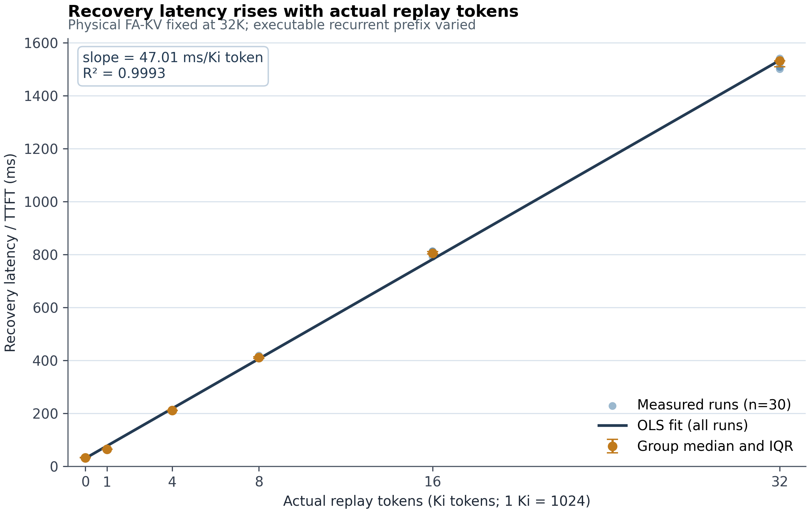

横轴实际replay tokens，纵轴服务端恢复/TTFT；每档5次，中位与IQR。原始30条保存在02_qwen/raw_runs.csv；本图逐字节复用。原拟合47.015 ms/Ki token、R²=0.999282是当前配置描述性近似，不是跨位置严格线性定律。

#### Qwen 128K长gap结果

| T（tokens） | G（tokens） | 测量次数 | TTFT均值（ms） | 中位数 | 标准差 | 相对同T基线成本（ms） |
|---|---|---|---|---|---|---|
| 131072 | 0 | 12 | 42.318310000000004 | 42.246998500000004 | 1.0172184463839706 | 0.0 |
| 131072 | 4096 | 12 | 343.74192124999996 | 344.40232249999997 | 2.592591270326418 | 301.42361124999996 |
| 131072 | 8192 | 12 | 666.1954525 | 667.4420215 | 4.772724050496037 | 623.8771425 |
| 131072 | 16384 | 12 | 1299.2796104166666 | 1297.7245035 | 7.10278633553342 | 1256.9613004166665 |
| 131072 | 32768 | 12 | 2484.67810725 | 2483.932823 | 11.500148338651329 | 2442.3597972499997 |
| 131072 | 49152 | 12 | 3636.335401166667 | 3637.8680595 | 12.155875056038251 | 3594.017091166667 |
| 131072 | 65536 | 12 | 4676.5382399166665 | 4675.9434870000005 | 14.439561584069697 | 4634.219929916667 |
| 131072 | 98304 | 12 | 6509.406134083333 | 6512.696962 | 11.12043917721673 | 6467.0878240833335 |
| 131072 | 131072 | 12 | 7974.29363225 | 7975.5537994999995 | 17.925248329900434 | 7931.97532225 |

#### Qwen target-position矩阵

| T（tokens） | G（tokens） | 测量次数 | TTFT均值（ms） | 中位数 | 标准差 | 相对同T基线成本（ms） |
|---|---|---|---|---|---|---|
| 32768 | 0 | 12 | 35.935815749999996 | 35.9832045 | 0.6483349366550276 | 0.0 |
| 32768 | 4096 | 12 | 209.9419946666667 | 210.144854 | 1.6199214918806322 | 174.0061789166667 |
| 32768 | 8192 | 12 | 400.1248944166667 | 399.883827 | 1.063450345123697 | 364.18907866666666 |
| 32768 | 16384 | 12 | 754.389325 | 754.6448505000001 | 4.113030124596747 | 718.45350925 |
| 32768 | 32768 | 12 | 1472.7426457499998 | 1473.439541 | 5.014728012141691 | 1436.8068299999998 |
| 65536 | 0 | 12 | 37.71565841666666 | 37.487811 | 1.2207060523863351 | 0.0 |
| 65536 | 4096 | 12 | 255.05265416666666 | 255.9940245 | 2.592272442003692 | 217.33699575 |
| 65536 | 8192 | 12 | 488.4603490833333 | 489.11058149999997 | 2.744491952755266 | 450.74469066666666 |
| 65536 | 16384 | 12 | 943.1414285833333 | 944.818419 | 6.025639255859634 | 905.4257701666667 |
| 65536 | 32768 | 12 | 1801.04449 | 1798.2716575 | 7.294032735819658 | 1763.3288315833333 |
| 98304 | 0 | 12 | 39.04974175 | 38.7497105 | 0.7018875539493005 | 0.0 |
| 98304 | 4096 | 12 | 298.0076706666667 | 298.4113575 | 2.434158458883039 | 258.9579289166667 |
| 98304 | 8192 | 12 | 576.8567473333334 | 578.027133 | 3.297312958823755 | 537.8070055833334 |
| 98304 | 16384 | 12 | 1120.7843291666666 | 1119.849027 | 10.295606358329456 | 1081.7345874166665 |
| 98304 | 32768 | 12 | 2147.96514375 | 2147.588768 | 6.7768324058468155 | 2108.915402 |
| 131072 | 0 | 12 | 41.55412366666666 | 41.60586 | 0.4309697044280349 | 0.0 |
| 131072 | 4096 | 12 | 343.799549 | 343.824433 | 3.2732281326077666 | 302.24542533333334 |
| 131072 | 8192 | 12 | 664.4598224166667 | 665.5128090000001 | 4.21635267124524 | 622.90569875 |
| 131072 | 16384 | 12 | 1301.3094720833333 | 1301.8004365 | 6.5773180491507555 | 1259.7553484166667 |
| 131072 | 32768 | 12 | 2491.0978365833334 | 2489.7083430000002 | 9.221664518461395 | 2449.5437129166667 |

20行包含四个G=0基线；16个非零点参与后续校准。表中原始TTFT与基线扣除成本同时保留，不能混称纯replay latency。

#### Kimi五组配对

| 配对 | 顺序 | A恢复（ms） | B恢复（ms） | B−A（ms） |
|---|---|---|---|---|
| 1 | A→B | 73.151000 | 821.563500 | 748.412500 |
| 2 | B→A | 70.813869 | 829.894119 | 759.080250 |
| 3 | A→B | 73.985595 | 825.251420 | 751.265825 |
| 4 | B→A | 71.011529 | 834.938277 | 763.926748 |
| 5 | A→B | 69.784901 | 848.055759 | 778.270858 |

平均B−A=760.191236 ms，中位759.080250 ms，5/5为正；10/10正确性与cleanup通过。此正式报告未给bootstrap CI，本手册不新增CI。每组不是一条自然工作流样本，而是同一固定设计的独立配对重复。

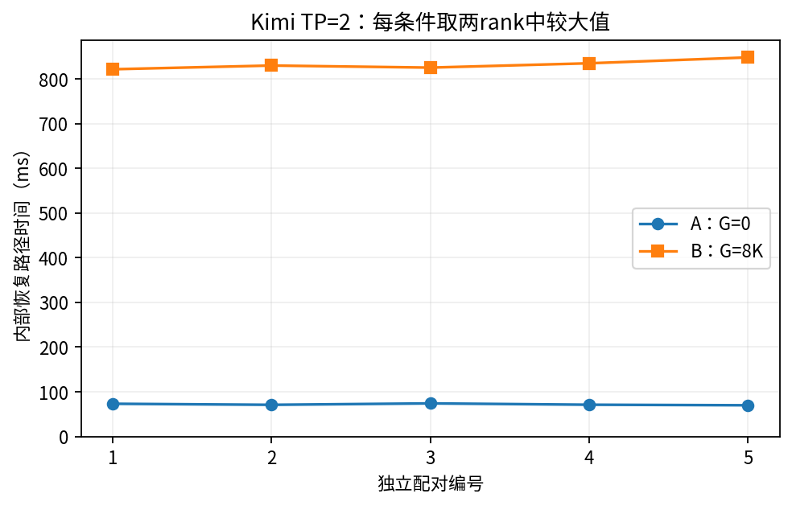

### 2.5 负面结果与边界

首轮128K目录`recovery_profiler_128k_20260826_133234_448476`仅完成1/126 trial即FAIL，原因是目标E=81920、实际E=126976；失败阶段为warmup。正式PASS来自随后独立目录`...133712_596813`，不得合并或隐去失败。位置审计记录gap_only_assumption=FAIL、legacy_reproduction=WEAK、discrepancy=MIXED，说明历史单变量曲线不能直接充当后续全域模型。Kimi Phase1的简化摘要也不能取代Phase3真实请求前沿；Phase3已显式处理残存中间checkpoint。

支持recurrent loss的真实恢复代价与位置依赖。不能声称严格线性、Kimi完整单调性、多token工作流性能或跨架构定量迁移。

### 2.6 来源

02_qwen/02_long/02_failed/02_position/02_kimi五类根目录见索引。Qwen有driver.py/analyze.py、server_formal.log、execution_order.json、raw_trials.csv、gap_audit.csv、position_matrix_raw.csv与server_command.txt；Kimi有plan.json、paired_measurements.json、10个runs/、correctness/和launch_command.txt。原命令文件转录见historical_commands.md，本轮没有执行其中任何命令。

## 实验3：Recovery Cost Model Accuracy

### 3.1 问题与假设

比较gap-only与两个位置感知候选模型，选择在独立目标位置上准确且满足结构约束的Phi。建模目标是相对同T的G=0基线恢复增量，不是请求完整TTFT。选择模型与证明其分配收益必要性是两个问题。

### 3.2 环境与数据划分

Qwen3.5-9B、SGLang0.5.17、单H100、TP1，context131200，pool24，extra_buffer、track256、无overlap/CUDA graph。20个校准点来自已完成的16个position-matrix非零点和4个128K long-gap点；不是从留出集中随机拆分。

留出T=49152/81920/114688，即48/80/112Ki；各G=0、T/8、T/4、T/2、3T/4。15条件，每条件2预热+12正式测量，共210raw行，其中180正式请求；误差评价使用12个非零配置均值，绝不能把210行称为210个独立模型测试点。

### 3.3 模型、校准与实际过程

`evaluation/recovery_model_freeze.py:255`构造留出配置，`:269`用seed20260826打乱后循环移位；`:308`只从校准点拟合。M0按固定gap knot对不同T的校准成本求均值，再线性插值；M1对[g,g*t]最小二乘；M2对[g,g*t,g²]最小二乘。g=G/1024、t=T/1024。

- M0：gap-only分段线性，共8个非零gap knots，另有固定(0,0)。
- M1：41.65918982589852g+0.19351438898438078g*t。
- M2：37.82814985789258g+0.34597414281318883g*t−0.15620191741171993g²。

config与model_selection记录heldout_used_for_fit=false；候选模型的heldout前后hash相同。预注册grade_model先要求结构PASS；MAPE>10%或最大相对误差>20%为FAIL；MAPE≤5%且最大相对误差≤10%为PASS，其余WEAK；只在PASS模型中按M0/M1/M2既定复杂度顺序选择。`:472`按每个T自己的G=0均值扣基线；原始heldout_raw.csv记录实际请求结果，heldout_predictions.csv保留12点逐模型预测与误差。正式入口文件记录`python -m evaluation.recovery_model_freeze`，无需猜测shell命令。

#### 全部校准点

| 来源 | T（tokens） | G（tokens） | 校准增量成本（ms） |
|---|---|---|---|
| position_matrix | 32768 | 4096 | 174.0061789166667 |
| position_matrix | 32768 | 8192 | 364.18907866666666 |
| position_matrix | 32768 | 16384 | 718.45350925 |
| position_matrix | 32768 | 32768 | 1436.8068299999998 |
| position_matrix | 65536 | 4096 | 217.33699575 |
| position_matrix | 65536 | 8192 | 450.74469066666666 |
| position_matrix | 65536 | 16384 | 905.4257701666667 |
| position_matrix | 65536 | 32768 | 1763.3288315833333 |
| position_matrix | 98304 | 4096 | 258.9579289166667 |
| position_matrix | 98304 | 8192 | 537.8070055833334 |
| position_matrix | 98304 | 16384 | 1081.7345874166665 |
| position_matrix | 98304 | 32768 | 2108.915402 |
| position_matrix | 131072 | 4096 | 302.24542533333334 |
| position_matrix | 131072 | 8192 | 622.90569875 |
| position_matrix | 131072 | 16384 | 1259.7553484166667 |
| position_matrix | 131072 | 32768 | 2449.5437129166667 |
| long_gap | 131072 | 49152 | 3594.017091166667 |
| long_gap | 131072 | 65536 | 4634.219929916667 |
| long_gap | 131072 | 98304 | 6467.0878240833335 |
| long_gap | 131072 | 131072 | 7931.97532225 |

### 3.4 结果与误差分布

| 模型 | MAE（ms） | MAPE（%） | 最大绝对误差（ms） | 最大相对误差（%） | R² | 门禁 |
|---|---|---|---|---|---|---|
| M0 | 287.514084 | 15.291275 | 956.106063 | 28.036457 | 0.931584 | FAIL |
| M1 | 79.648757 | 4.635750 | 276.426245 | 11.664183 | 0.993385 | WEAK |
| M2 | 31.179583 | 2.682480 | 80.726854 | 8.179469 | 0.999389 | PASS |

| T | G | 实测增量（ms） | M0预测 | M1预测 | M2预测 | M2相对误差（%） |
|---|---|---|---|---|---|---|
| 49152 | 6144 | 296.71636175 | 366.0241253229167 | 305.6872829828928 | 320.986183250732 | 8.179469 |
| 49152 | 12288 | 602.0566070833335 | 742.6269611145833 | 611.3745659657856 | 630.72582844782 | 4.761881 |
| 49152 | 24576 | 1226.29593375 | 1465.4954989687499 | 1222.7491319315711 | 1216.4655046810649 | 0.801636 |
| 49152 | 36864 | 1837.9458825000002 | 2353.2407933854165 | 1834.1236978973568 | 1757.2190286997343 | 4.392232 |
| 81920 | 10240 | 610.9030343333334 | 618.269289765625 | 571.4034094464898 | 639.4406210883049 | 4.671377 |
| 81920 | 20480 | 1237.38388225 | 1228.418901390625 | 1142.8068188929797 | 1247.6408586942657 | 0.828924 |
| 81920 | 40960 | 2401.8814380833337 | 2766.8328926458335 | 2285.6136377859593 | 2370.3201834591555 | 1.314022 |
| 81920 | 61440 | 3418.063157083334 | 4374.169220229167 | 3428.4204566789394 | 3368.0379742946693 | 1.463553 |
| 114688 | 14336 | 1003.7369268333333 | 866.9846324635416 | 886.6592194900884 | 1041.465978128879 | 3.758859 |
| 114688 | 28672 | 2006.3024713333334 | 1702.572096546875 | 1773.3184389801768 | 2021.700804632364 | 0.767498 |
| 114688 | 57344 | 3823.0631233333334 | 4114.118510541667 | 3546.6368779603536 | 3798.477002763151 | 0.643100 |
| 114688 | 86016 | 5362.892757833334 | 5779.762363770833 | 5319.95531694053 | 5330.328594392361 | 0.607213 |

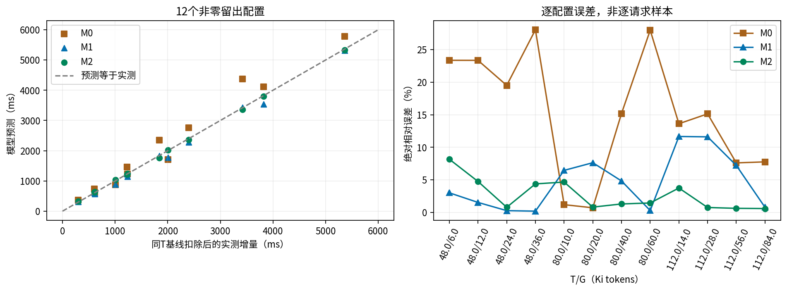

左图横轴为真实基线扣除成本、纵轴为预测，虚线是相等线；右图为按T/G排列的12配置绝对相对误差，不是时间序列。数据全来自冻结predictions，无重新拟合。分T与G/T的误差在model_selection.json/by_target/by_recovery_fraction中完整保存。

RQ2独立审计重复得到M2 MAPE2.682480%、MAE31.179583 ms，最大相对误差8.179469%；结构网格147/147，Phi(0,T)=0、非负、固定T单调，域0≤G≤T≤131072。正式部署系数以发布精度序列化，审计确认与fit的差异在5e-7门限内；不能声称两个文件逐字节相同。

### 3.5 支持与不支持

直接证据支持本模型/硬件/执行域内M2优于两个候选的误差表现；M0=FAIL、M1=WEAK、M2=PASS全部保留。heldout未参与拟合，但参与模型选择，不能把它描述成在最终模型选择之后仍完全未触及的第三个测试集。没有额外独立最终测试集证据。不能从预测准确性推导最终分配优于LDR/WFC；现有allocation消融没有此额外最终收益。

### 3.6 来源

03_model/{calibration_points.csv,candidate_models.json,heldout_raw.csv,heldout_summary.csv,heldout_predictions.csv,model_selection.json,structural_validation.json,config.json,execution_order.json,server_command.txt}；03_audit/{final_report.md,recomputed_metrics.json,canonical_model.json,rq2_rq3_consistency.json}。脚本recovery_model_freeze.py与rq2_canonical_model_audit.py；本轮只对冻结误差字段重算MAE/MAPE核对，不执行拟合或GPU。

## 实验4：Overall Allocation Quality

### 4.1 问题与假设

固定policy-blind快照、同一候选/预算/共同目标，比较不同保留规则的最终可执行恢复成本。主张对象是冻结分布上的CPU modeled allocation，不是直接GPU speedup。

### 4.2 环境、总体与预算

OpenHands来自`/home/wjg/data/agentic_coding_trajectories/sessions.parquet`，来源过滤nebius-swe-rebench-openhands；5000唯一sessions，2650满足n_turns≥60及前六轮输入≤131072。seed20260903按session ID哈希排序，以四session成组；预指定200组、每round2/3/4/5各50组，不能失败补位。collector使用Qwen、单H100、pool28和context131200，独立engine、串行物化，无策略干预。

AgentX正式23个snapshot来自B1 census和有效B2形状回放根，非OpenHands文本采样；其CPU评价69条件，没有该评价阶段的GPU性能测量。所有方法共用formal compatibility。25%/50%/75%预算K=max(1,floor(r|C|))，等大小逻辑checkpoint计费，排除K≥|C| trivial；不能自动等同于物理池上限。

### 4.3 快照构造与实际执行

**OpenHands，RECORDED：**每组独立engine重放四条workflow到round r结束；在r+1输入已知且未执行时无副作用读取FA frontier。候选是历史实际物化且recurrent/FA驻留、有完整runtime node/handle/prefix digest、满足等大小和access provenance的checkpoint。候选数8–20，pending恰4；至少两个workflow竞争只是旧准入定义，不保证K<K_min。禁止使用r+2及之后内容、访问或时延。每个group保存snapshot、eligibility、runtime_correctness、worker和lifecycle记录。

结果200 attempted、168 eligible、32 failed；32个失败原因均non_monotonic_inputs，无替补。不得把有效168说成随机从200中按性能筛选。冻结digest及workflow set唯一，采集时没有运行selector、Exact OPT或逻辑驱逐。

**AgentX，RECORDED+来源限制：**有效B2为`/home/wjg/data/agentx/audits/agentx_runtime_formal_20260906_023649`，无效`...085021`未用于formal eval。collector串行执行已完成请求形状并观察状态，使用确定性BLOCK_SHAPE token重建；原始Claude轨迹的hash/history不等于Qwen原生状态。P2确认parent/fork与current-context pending含派生成分，没有原生ready/queued证据。formal manifest可支持既定兼容矩阵上的CPU比较，不能证明真实同一时刻多分支ready。

一般定义：T=min(anchor_pos, resident_FA_frontier)，L为候选实际recurrent prefix位置。兼容性要求同workflow且候选lineage是pending路径前缀、L≤T；E=max({兼容且选中L}∪{0})，G=T−E。OpenHands四workflow收益支持互不共享；AgentX以冻结formal兼容矩阵为准，不能临时改回B2 raw token-LCP兼容。`flowstate/workflow.py`、`state_catalog.py`、`executable_state.py`及`rq3_frozen_snapshot_evaluator.py`定义共同计算。

策略选择完成后以同一个冻结Phi评分；每个条件检查snapshot digest前后不变及确定性。P4-G1统一表读取原始正式结果及P1-B共同评分并核验误差≤1e-9，不重跑selector。本轮直接逐字节归档P4-G1矩阵。

### 4.4 各基线的实际选择规则

| 方法 | 输入与排序/停止规则 | 定位 |
|---|---|---|
| LRU | 当前候选last_access_order递减，其次creation_order递减，最后ID升序，取至多K | 逻辑保留适配，不修改SGLang native LRU实现 |
| LFU | 已完成write-back覆盖祖先的频率递减，其次last_access_order递减，最后ID升序；创建计首次访问，单请求单checkpoint最多+1；取K | LFU Adaptation，不是原生recurrent LFU |
| Marconi | 当前候选recency与flop_saved/memory分别min-max归一化，utility=recency_norm+alpha*efficiency_norm，降序/ID取K | 用冻结alpha与metadata；不是完整Marconi系统 |
| StandaloneTopK | 从空集计算Σpending独立收益，静态降序/既定tie规则，保留正收益至K，不随选择更新marginal | 对应without_set_dependent |
| PCB | 每pending独立推荐最高正收益checkpoint；推荐按收益降序、checkpoint ID、pending ID排序；唯一ID去重计费，至K | 使用Phi，但不是完整集合贪心 |
| LDR | 每pending推荐最深合法正L；推荐按L降序/ID排序，去重至K | 不读Phi，长度代理 |
| WFC | 动态E；候选q=正前沿推进pending数，r=推进token总和；按q、r递减及ID选，q=0停止，至K | 共享覆盖启发式，不读Phi |
| FlowState | 以当前集合的总恢复成本下降为marginal逐步选择；确定性tie，非正改善停止或到K | set-dependent目标，正收益去冗余 |

正式容差与tie规则以`flowstate/optimizer.py:112`、`evaluation/rq5_frozen_snapshot_ablation.py`、`evaluation/sota_policies.py:100,253`及P1-B的pcb.py/ldr.py/wfc.py为准。三强基线没有读取其他策略输出，P1-B用独立scoring与无Phi guard核查；本轮不重复该测试。

### 4.5 完整数值与主图

以下48行直接复用P4-G1；C为每snapshot所有pending的modeled ms。差=baseline−FlowState，胜/平/负从FlowState视角、1e-9容差。同集合忽略顺序。每预算分母168或23，三预算是重复条件，不把573视为独立样本。

| 数据集 | 预算 | 方法 | N | mean | median | mean差 | W/T/L | Full Coverage | 同集合 | K<K_min |
|---|---|---|---:|---:|---:|---:|---|---|---|---|
| AgentX | 25% | FlowState | 23 | 7044.031074 | 6960.591126 | 0.000000 | 0/23/0 | 0/23 | 23/23 | 0/23 |
| AgentX | 25% | LDR | 23 | 7044.031074 | 6960.591126 | 0.000000 | 0/23/0 | 0/23 | 23/23 | 0/23 |
| AgentX | 25% | LFU | 23 | 7661.371270 | 7237.854271 | 617.340196 | 7/16/0 | 0/23 | 3/23 | 0/23 |
| AgentX | 25% | LRU | 23 | 8009.159326 | 7396.436137 | 965.128252 | 11/12/0 | 0/23 | 0/23 | 0/23 |
| AgentX | 25% | Marconi | 23 | 7261.507014 | 7237.854271 | 217.475940 | 12/11/0 | 0/23 | 0/23 | 0/23 |
| AgentX | 25% | PCB | 23 | 7044.031074 | 6960.591126 | 0.000000 | 0/23/0 | 0/23 | 23/23 | 0/23 |
| AgentX | 25% | StandaloneTopK | 23 | 7244.451689 | 7239.810796 | 200.420616 | 2/21/0 | 0/23 | 15/23 | 0/23 |
| AgentX | 25% | WFC | 23 | 7044.031074 | 6960.591126 | 0.000000 | 0/23/0 | 0/23 | 23/23 | 0/23 |
| AgentX | 50% | FlowState | 23 | 7044.031074 | 6960.591126 | 0.000000 | 0/23/0 | 0/23 | 23/23 | 0/23 |
| AgentX | 50% | LDR | 23 | 7044.031074 | 6960.591126 | 0.000000 | 0/23/0 | 0/23 | 23/23 | 0/23 |
| AgentX | 50% | LFU | 23 | 7245.617686 | 6974.928220 | 201.586612 | 4/19/0 | 0/23 | 0/23 | 0/23 |
| AgentX | 50% | LRU | 23 | 7238.294567 | 6960.591126 | 194.263493 | 3/20/0 | 0/23 | 0/23 | 0/23 |
| AgentX | 50% | Marconi | 23 | 7057.545877 | 7015.977857 | 13.514804 | 3/20/0 | 0/23 | 0/23 | 0/23 |
| AgentX | 50% | PCB | 23 | 7044.031074 | 6960.591126 | 0.000000 | 0/23/0 | 0/23 | 23/23 | 0/23 |
| AgentX | 50% | StandaloneTopK | 23 | 7044.031074 | 6960.591126 | 0.000000 | 0/23/0 | 0/23 | 15/23 | 0/23 |
| AgentX | 50% | WFC | 23 | 7044.031074 | 6960.591126 | 0.000000 | 0/23/0 | 0/23 | 23/23 | 0/23 |
| AgentX | 75% | FlowState | 23 | 7044.031074 | 6960.591126 | 0.000000 | 0/23/0 | 0/23 | 23/23 | 0/23 |
| AgentX | 75% | LDR | 23 | 7044.031074 | 6960.591126 | 0.000000 | 0/23/0 | 0/23 | 23/23 | 0/23 |
| AgentX | 75% | LFU | 23 | 7057.929179 | 6960.591126 | 13.898106 | 1/22/0 | 0/23 | 0/23 | 0/23 |
| AgentX | 75% | LRU | 23 | 7130.113983 | 6960.591126 | 86.082909 | 2/21/0 | 0/23 | 0/23 | 0/23 |
| AgentX | 75% | Marconi | 23 | 7044.571595 | 6960.591126 | 0.540521 | 1/22/0 | 0/23 | 0/23 | 0/23 |
| AgentX | 75% | PCB | 23 | 7044.031074 | 6960.591126 | 0.000000 | 0/23/0 | 0/23 | 23/23 | 0/23 |
| AgentX | 75% | StandaloneTopK | 23 | 7044.031074 | 6960.591126 | 0.000000 | 0/23/0 | 0/23 | 15/23 | 0/23 |
| AgentX | 75% | WFC | 23 | 7044.031074 | 6960.591126 | 0.000000 | 0/23/0 | 0/23 | 23/23 | 0/23 |
| OpenHands | 25% | FlowState | 168 | 129.504564 | 159.270212 | 0.000000 | 0/168/0 | 71/168 | 168/168 | 90/168 |
| OpenHands | 25% | LDR | 168 | 129.504564 | 159.270212 | 0.000000 | 0/168/0 | 71/168 | 168/168 | 90/168 |
| OpenHands | 25% | LFU | 168 | 479.838122 | 403.550799 | 350.333558 | 168/0/0 | 0/168 | 0/168 | 90/168 |
| OpenHands | 25% | LRU | 168 | 428.870335 | 433.698683 | 299.365771 | 168/0/0 | 0/168 | 0/168 | 90/168 |
| OpenHands | 25% | Marconi | 168 | 321.141758 | 336.274235 | 191.637194 | 163/5/0 | 4/168 | 1/168 | 90/168 |
| OpenHands | 25% | PCB | 168 | 129.504564 | 159.270212 | 0.000000 | 0/168/0 | 71/168 | 168/168 | 90/168 |
| OpenHands | 25% | StandaloneTopK | 168 | 258.779872 | 240.121339 | 129.275308 | 96/72/0 | 18/168 | 60/168 | 90/168 |
| OpenHands | 25% | WFC | 168 | 129.504564 | 159.270212 | 0.000000 | 0/168/0 | 71/168 | 168/168 | 90/168 |
| OpenHands | 50% | FlowState | 168 | 3.370698 | 0.000000 | 0.000000 | 0/168/0 | 156/168 | 168/168 | 0/168 |
| OpenHands | 50% | LDR | 168 | 3.370698 | 0.000000 | 0.000000 | 0/168/0 | 156/168 | 168/168 | 0/168 |
| OpenHands | 50% | LFU | 168 | 297.455947 | 220.260322 | 294.085249 | 168/0/0 | 0/168 | 0/168 | 0/168 |
| OpenHands | 50% | LRU | 168 | 146.387968 | 164.197398 | 143.017270 | 90/78/0 | 71/168 | 0/168 | 0/168 |
| OpenHands | 50% | Marconi | 168 | 121.429326 | 173.932488 | 118.058628 | 131/37/0 | 32/168 | 0/168 | 0/168 |
| OpenHands | 50% | PCB | 168 | 3.370698 | 0.000000 | 0.000000 | 0/168/0 | 156/168 | 168/168 | 0/168 |
| OpenHands | 50% | StandaloneTopK | 168 | 50.596930 | 0.000000 | 47.226232 | 46/122/0 | 114/168 | 13/168 | 0/168 |
| OpenHands | 50% | WFC | 168 | 3.370698 | 0.000000 | 0.000000 | 0/168/0 | 156/168 | 168/168 | 0/168 |
| OpenHands | 75% | FlowState | 168 | 3.370698 | 0.000000 | 0.000000 | 0/168/0 | 156/168 | 168/168 | 0/168 |
| OpenHands | 75% | LDR | 168 | 3.370698 | 0.000000 | 0.000000 | 0/168/0 | 156/168 | 168/168 | 0/168 |
| OpenHands | 75% | LFU | 168 | 178.263503 | 119.807483 | 174.892805 | 168/0/0 | 0/168 | 0/168 | 0/168 |
| OpenHands | 75% | LRU | 168 | 53.833812 | 0.000000 | 50.463114 | 48/120/0 | 109/168 | 0/168 | 0/168 |
| OpenHands | 75% | Marconi | 168 | 29.739345 | 29.296244 | 26.368647 | 92/76/0 | 69/168 | 0/168 | 0/168 |
| OpenHands | 75% | PCB | 168 | 3.370698 | 0.000000 | 0.000000 | 0/168/0 | 156/168 | 168/168 | 0/168 |
| OpenHands | 75% | StandaloneTopK | 168 | 4.772787 | 0.000000 | 1.402090 | 2/166/0 | 155/168 | 0/168 | 0/168 |
| OpenHands | 75% | WFC | 168 | 3.370698 | 0.000000 | 0.000000 | 0/168/0 | 156/168 | 168/168 | 0/168 |

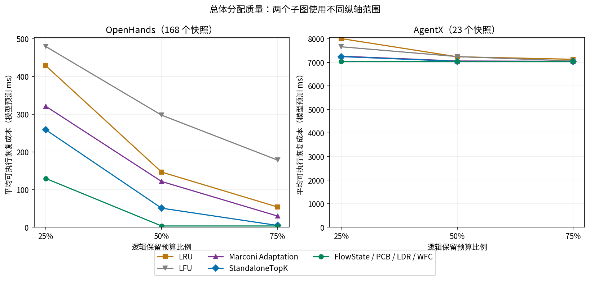

两个面板纵轴范围不同，单位modeled ms；横轴三个既定预算。FlowState/PCB/LDR/WFC完全重合，没有视觉偏移。完整精度、原始成本和来源行见tables/overall_allocation_matrix.csv及per_case_evidence.csv。

Full Coverage正式判定为C(S)≤1e-9；P4-G1核对全部4584方法–条件记录，与所有pending的整数G=0等价。它不同于达到全候选最大前沿：OpenHands50%时四强方法168/168达到候选前沿，但只有156/168 G全零。AgentX所有snapshot有不可消除residual，因此Full Coverage全0但保留仍可减少成本。

### 4.6 分析与来源

OpenHands低预算下旧策略可能在单链重复保留；无共享支持使PCB可精确化简，90个K<4条件仍与FlowState等价。预算升至50%后全候选前沿均可实现，但12个snapshot的target仍有不可消除gap。AgentX正收益共享22/23，然而K_min仅0–2，全部预算足以实现全候选前沿，FlowState曲线保持7044.031 modeled ms的平台；不能解释为预算无任何物理意义或每个请求已完整命中。

源代码：rq3_openhands_neutral_collector.py、rq3_formal_policy_evaluation.py、agentx_runtime_snapshot_collection.py、rq3_agentx_formal_policy_evaluation.py。配置：04_collection/protocol.json、FORMAL_COLLECTION.json，04_oh/EVALUATION_PROTOCOL.json，04_ax/manifest.json及formal_snapshot_manifest.json。原始per_snapshot/per_case、aggregate、determinism、source_integrity与P4-G1来源清单均已索引。未找到统一宿主机完整shell历史的流程标记RECONSTRUCTED_FROM_CODE；collector完成状态与每组结果不是只靠代码推断。

## 实验5：Strong Baseline & Mechanism Attribution

### 5.1 研究问题、环境与执行

P0是已有573条件的只读机制归因；P1是数学/设计审查；P1-B是已完成的CPU-only新基线验证；三者均不能称为GPU对照。输入为OpenHands504条件与AgentX69条件，冻结候选、compatibility、Phi与K不变。

P1-B先实现PCB并通过573条件强制等价门禁，再按预先冻结定义执行LDR/WFC；implementation_lock.json记录源码锁定。对所有集合核对预算、合法性、逐pending E/G及共同成本；独立Decimal评分1719项、排列不变性1719项、LDR/WFC不读Phi guard1146项。边界测试10/10、旧参考集合评分2865/2865均在旧报告中记录PASS。本轮未执行它们。

### 5.2 最终目标、集合、顺序及容量

| 基线 | 最终目标相同 | 最终集合相同 | E/G相同 | 顺序不同 |
|---|---:|---:|---:|---:|
| PCB | 573/573 | 573/573 | 573/573 | 9 |
| LDR | 573/573 | 573/573 | 573/573 | 12 |
| WFC | 573/573 | 573/573 | 573/573 | 21 |

原P1-B成本差恰为0，不是扩大容差得出。OpenHands顺序差PCB0、LDR3、WFC3；AgentX9、9、18。不能把部分顺序变化解释成最终收益。

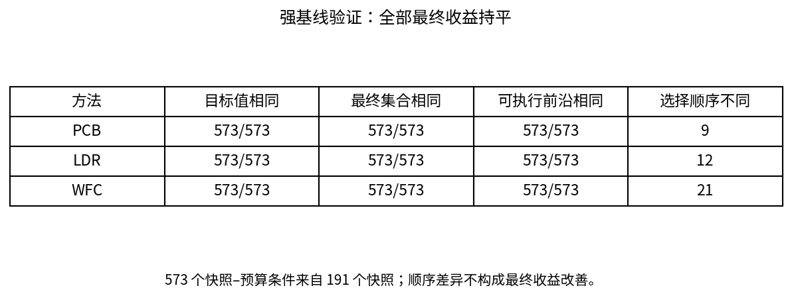

K_min_frontier是达到全候选可实现逐pending最深前沿的最少checkpoint数，不是实现G=0的最少数。OpenHands全部K_min=4，90/504个条件受限；AgentX27条件K_min2、39条件K_min1、3条件K_min0，69/69的K均不小于K_min。零分母比值应为不适用，非0。

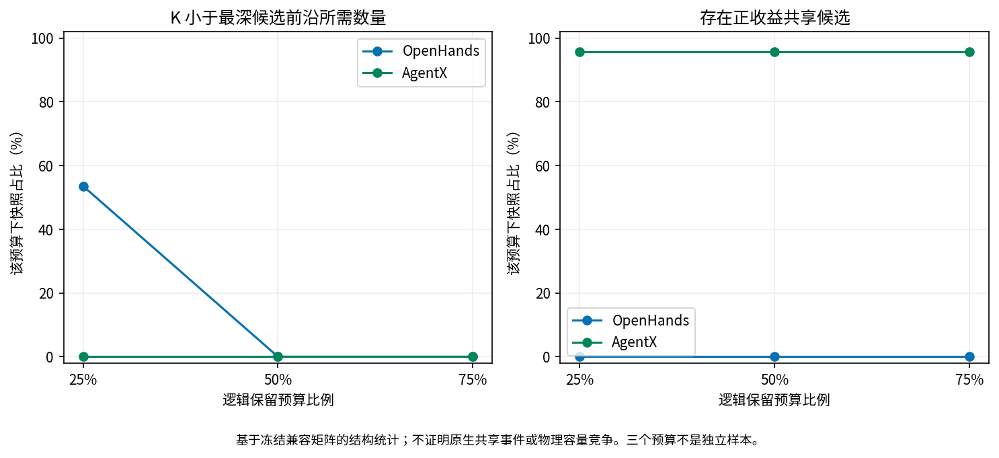

AgentX66/69正收益共享、48/69某贪心步对多个pending有正新增收益、9/69联合排序反转，均来自23快照的三预算。只有2/69严格优于StandaloneTopK，这两例新增边际在第二步只来自一个尚未覆盖pending，不能隔离成同时多分支收益。P0相对TopK的OpenHands严格胜例144/504；相对三强基线全0。

### 5.3 Exact OPT与消融

Exact仅限Σ(i=0..min(K,n))C(n,i)≤100000的既有结果（rq3_formal_policy_evaluation.py:44,183,532），不重跑穷举。

| 数据集 | 预算 | 匹配数 | 有Exact结果的条件数 |
|---|---|---|---|
| OpenHands | 0.25 | 168 | 168 |
| OpenHands | 0.5 | 133 | 133 |
| OpenHands | 0.75 | 133 | 133 |
| OpenHands | 全部预算 | 434 | 434 |
| AgentX | 0.25 | 18 | 18 |
| AgentX | 0.5 | 16 | 16 |
| AgentX | 0.75 | 14 | 14 |
| AgentX | 全部预算 | 48 | 48 |
| 总体 | 0.25 | 186 | 186 |
| 总体 | 0.5 | 149 | 149 |
| 总体 | 0.75 | 147 | 147 |
| 总体 | 全部预算 | 482 | 482 |

482是snapshot–budget实例数，不是482独立快照；91个超阈值条件无Exact结果，不能计为胜/负。匹配objective不要求集合唯一，也不证明一般贪心最优。

去位置感知消融在OpenHands504、AgentX69条件上目标、集合和顺序都相同。StandaloneTopK分别W/T/L=144/360/0及2/67/0，集合不同431及24条件；不同集合大量对应同前沿/同目标。LDR的g051顺序差属于不同基线，不能冒称为去位置感知消融差异。

### 5.4 七个代表案例的完整记录（P0冻结表归档）

所有成本单位均为模型预测 ms，不代表 runtime latency。案例在全量 573 cases 审计完成后按以下规则确定。C 编号只用于本案例内映射；P 编号顺序与冻结 per-continuation 记录一致。

#### 案例 A：rq3-openhands-main-g186-round4

选择规则：OpenHands 对 Marconi 最大绝对改善；同时也是对 StandaloneTopK 最大改善。预算 25%，K=4；候选 16，待续请求 4。

冻结来源：`/home/wjg/code/FlowState/evaluation/runtime_artifacts/rq3_formal_policy_eval_20260904_110011/per_snapshot_results.jsonl:463`。完整矩阵、全部候选每步 marginal、血缘/metadata 和原始 ID 见 [case_A.json](/home/wjg/code/FlowState/evaluation/p0_allocation_mechanism_audit/case_A.json)。

| 请求 | 原始 continuation ID | T | workflow（冻结编码） |
|---|---|---:|---|
| P1 | `RQ3_G186_A_PENDING_TURN_005` | 8832 | `nebius-swe-rebench-openhands::chatcmpl-e4535f7b0d208d13e2892a0dbb388496` |
| P2 | `RQ3_G186_B_PENDING_TURN_005` | 6144 | `nebius-swe-rebench-openhands::chatcmpl-9b28ea19360ff9a29e10ccd0805a847e` |
| P3 | `RQ3_G186_C_PENDING_TURN_005` | 15296 | `nebius-swe-rebench-openhands::chatcmpl-fe2e01aaeb9955f5968685c153778505` |
| P4 | `RQ3_G186_D_PENDING_TURN_005` | 4736 | `nebius-swe-rebench-openhands::chatcmpl-37aa034e029c1b2555b8288ead49d267` |

OpenHands 的四个 pending 对应独立 workflow、不同 lineage；AgentX 的表中 workflow 是正式兼容编码，真实完整 lineage 路径未被本轮读取的正式 manifest 保存，标记 UNKNOWN。AgentX 使用 manifest 的正式兼容集合，不能从 ID 字面推断真实血缘。

| 候选 | 原始 checkpoint ID | L | 可用于 objective 的 pending | 各 pending 的 standalone benefit（按 P 顺序） |
|---|---|---:|---|---|
| C1 | `RQ3_G186_A_TURN_001` | 4096 | P1 | 154.970, 0.000, 0.000, 0.000 |
| C2 | `RQ3_G186_A_TURN_002` | 4416 | P1 | 167.288, 0.000, 0.000, 0.000 |
| C3 | `RQ3_G186_A_TURN_003` | 6464 | P1 | 246.842, 0.000, 0.000, 0.000 |
| C4 | `RQ3_G186_A_TURN_004` | 8832 | P1 | 340.385, 0.000, 0.000, 0.000 |
| C5 | `RQ3_G186_B_TURN_001` | 2432 | P2 | 0.000, 91.201, 0.000, 0.000 |
| C6 | `RQ3_G186_B_TURN_002` | 5248 | P2 | 0.000, 199.004, 0.000, 0.000 |
| C7 | `RQ3_G186_B_TURN_003` | 6016 | P2 | 0.000, 228.815, 0.000, 0.000 |
| C8 | `RQ3_G186_B_TURN_004` | 6144 | P2 | 0.000, 233.801, 0.000, 0.000 |
| C9 | `RQ3_G186_C_TURN_001` | 14016 | P3 | 0.000, 0.000, 553.901, 0.000 |
| C10 | `RQ3_G186_C_TURN_002` | 14400 | P3 | 0.000, 0.000, 569.900, 0.000 |
| C11 | `RQ3_G186_C_TURN_003` | 15104 | P3 | 0.000, 0.000, 599.345, 0.000 |
| C12 | `RQ3_G186_C_TURN_004` | 15296 | P3 | 0.000, 0.000, 607.402, 0.000 |
| C13 | `RQ3_G186_D_TURN_001` | 3456 | P4 | 0.000, 0.000, 0.000, 129.973 |
| C14 | `RQ3_G186_D_TURN_002` | 3712 | P4 | 0.000, 0.000, 0.000, 139.742 |
| C15 | `RQ3_G186_D_TURN_003` | 4160 | P4 | 0.000, 0.000, 0.000, 156.886 |
| C16 | `RQ3_G186_D_TURN_004` | 4736 | P4 | 0.000, 0.000, 0.000, 179.015 |

| 策略 | 选中集合（编号） | C(S), ms | 相对 FlowState 多出的成本, ms |
|---|---|---:|---:|
| FlowState | C12, C4, C8, C16 | 0.000 | 0.000 |
| LFU | C13, C9, C5, C1 | 430.557 | 430.557 |
| LRU | C16, C15, C12, C11 | 574.186 | 574.186 |
| Marconi | C9, C16, C15, C11 | 582.242 | 582.242 |
| StandaloneTopK | C9, C10, C11, C12 | 753.200 | 753.200 |

StandaloneTopK 完整正收益静态排序：C12 → C11 → C10 → C9 → C4 → C3 → C8 → C7 → C6 → C16 → C2 → C15 → C1 → C14 → C13 → C5。

| 贪心步 | 选中 checkpoint | 当前 marginal, ms | 选择前 u（按 P 顺序）, ms | 本步逐 pending 新增收益, ms |
|---|---|---:|---|---|
| 1 | C12 | 607.402 | 0.000, 0.000, 0.000, 0.000 | 0.000, 0.000, 607.402, 0.000 |
| 2 | C4 | 340.385 | 0.000, 0.000, 607.402, 0.000 | 340.385, 0.000, 0.000, 0.000 |
| 3 | C8 | 233.801 | 340.385, 0.000, 607.402, 0.000 | 0.000, 233.801, 0.000, 0.000 |
| 4 | C16 | 179.015 | 340.385, 233.801, 607.402, 0.000 | 0.000, 0.000, 0.000, 179.015 |

首个分歧：第 2 步；共同 retained set = ['C12']。
- flowstate：C4；独立收益 340.385 ms；相对上述 retained set 的 marginal 340.385 ms。
- standalone：C11；独立收益 599.345 ms；相对上述 retained set 的 marginal 0.000 ms。

| 请求 | 策略 | E | G | C_p, ms | baseline − FlowState, ms |
|---|---|---:|---:|---:|---:|
| P1 | FlowState | 8832 | 0 | 0.000 | 0.000 |
| P2 | FlowState | 6144 | 0 | 0.000 | 0.000 |
| P3 | FlowState | 15296 | 0 | 0.000 | 0.000 |
| P4 | FlowState | 4736 | 0 | 0.000 | 0.000 |
| P1 | LFU | 4096 | 4736 | 185.415 | 185.415 |
| P2 | LFU | 2432 | 3712 | 142.599 | 142.599 |
| P3 | LFU | 14016 | 1280 | 53.501 | 53.501 |
| P4 | LFU | 3456 | 1280 | 49.041 | 49.041 |
| P1 | LRU | 0 | 8832 | 340.385 | 340.385 |
| P2 | LRU | 0 | 6144 | 233.801 | 233.801 |
| P3 | LRU | 15296 | 0 | 0.000 | 0.000 |
| P4 | LRU | 4736 | 0 | 0.000 | 0.000 |
| P1 | Marconi | 0 | 8832 | 340.385 | 340.385 |
| P2 | Marconi | 0 | 6144 | 233.801 | 233.801 |
| P3 | Marconi | 15104 | 192 | 8.056 | 8.056 |
| P4 | Marconi | 4736 | 0 | 0.000 | 0.000 |
| P1 | StandaloneTopK | 0 | 8832 | 340.385 | 340.385 |
| P2 | StandaloneTopK | 0 | 6144 | 233.801 | 233.801 |
| P3 | StandaloneTopK | 15296 | 0 | 0.000 | 0.000 |
| P4 | StandaloneTopK | 0 | 4736 | 179.015 | 179.015 |

Marconi 价值信号：原始 last_access_order、marconi_flop_saved、alpha 和归一化 utility 均见本案例 JSON；以原始 utility 重新排序，选中集合核对通过。

Marconi 最终集合中可删除而不增加成本的 checkpoint：C9, C15。对每个 c，检查的是 Δ(c | S_Marconi \ {c})；这里的 retained set 由本节完整选中集合明确给出，绝不把它当成 Marconi 内部选择顺序。

#### 案例 B：rq3-openhands-main-g073-round3

选择规则：OpenHands 对 Marconi 严格改善排序的下中位案例。预算 25%，K=3；候选 12，待续请求 4。

冻结来源：`/home/wjg/code/FlowState/evaluation/runtime_artifacts/rq3_formal_policy_eval_20260904_110011/per_snapshot_results.jsonl:184`。完整矩阵、全部候选每步 marginal、血缘/metadata 和原始 ID 见 [case_B.json](/home/wjg/code/FlowState/evaluation/p0_allocation_mechanism_audit/case_B.json)。

| 请求 | 原始 continuation ID | T | workflow（冻结编码） |
|---|---|---:|---|
| P1 | `RQ3_G073_A_PENDING_TURN_004` | 4352 | `nebius-swe-rebench-openhands::chatcmpl-47252e2b3626e348bf795ecdba300eb6` |
| P2 | `RQ3_G073_B_PENDING_TURN_004` | 5056 | `nebius-swe-rebench-openhands::chatcmpl-14c2bbcf85bf22575ca5200f900c0167` |
| P3 | `RQ3_G073_C_PENDING_TURN_004` | 4800 | `nebius-swe-rebench-openhands::chatcmpl-e38652061c3298ebad56ad8202c5ea67` |
| P4 | `RQ3_G073_D_PENDING_TURN_004` | 4928 | `nebius-swe-rebench-openhands::chatcmpl-793609b8ba2e43854b96894fce4c46fe` |

OpenHands 的四个 pending 对应独立 workflow、不同 lineage；AgentX 的表中 workflow 是正式兼容编码，真实完整 lineage 路径未被本轮读取的正式 manifest 保存，标记 UNKNOWN。AgentX 使用 manifest 的正式兼容集合，不能从 ID 字面推断真实血缘。

| 候选 | 原始 checkpoint ID | L | 可用于 objective 的 pending | 各 pending 的 standalone benefit（按 P 顺序） |
|---|---|---:|---|---|
| C1 | `RQ3_G073_A_TURN_001` | 3392 | P1 | 127.492, 0.000, 0.000, 0.000 |
| C2 | `RQ3_G073_A_TURN_002` | 3712 | P1 | 139.697, 0.000, 0.000, 0.000 |
| C3 | `RQ3_G073_A_TURN_003` | 4352 | P1 | 164.197, 0.000, 0.000, 0.000 |
| C4 | `RQ3_G073_B_TURN_001` | 2432 | P2 | 0.000, 91.117, 0.000, 0.000 |
| C5 | `RQ3_G073_B_TURN_002` | 4480 | P2 | 0.000, 169.213, 0.000, 0.000 |
| C6 | `RQ3_G073_B_TURN_003` | 5056 | P2 | 0.000, 191.403, 0.000, 0.000 |
| C7 | `RQ3_G073_C_TURN_001` | 3776 | P3 | 0.000, 0.000, 142.196, 0.000 |
| C8 | `RQ3_G073_C_TURN_002` | 4160 | P3 | 0.000, 0.000, 156.894, 0.000 |
| C9 | `RQ3_G073_C_TURN_003` | 4800 | P3 | 0.000, 0.000, 181.489, 0.000 |
| C10 | `RQ3_G073_D_TURN_001` | 3520 | P4 | 0.000, 0.000, 0.000, 132.435 |
| C11 | `RQ3_G073_D_TURN_002` | 3904 | P4 | 0.000, 0.000, 0.000, 147.106 |
| C12 | `RQ3_G073_D_TURN_003` | 4928 | P4 | 0.000, 0.000, 0.000, 186.443 |

| 策略 | 选中集合（编号） | C(S), ms | 相对 FlowState 多出的成本, ms |
|---|---|---:|---:|
| FlowState | C6, C12, C9 | 164.197 | 0.000 |
| LFU | C10, C7, C4 | 357.785 | 193.588 |
| LRU | C12, C11, C9 | 355.600 | 191.403 |
| Marconi | C10, C7, C5 | 279.689 | 115.491 |
| StandaloneTopK | C6, C9, C12 | 164.197 | 0.000 |

StandaloneTopK 完整正收益静态排序：C6 → C12 → C9 → C5 → C3 → C8 → C11 → C7 → C2 → C10 → C1 → C4。

| 贪心步 | 选中 checkpoint | 当前 marginal, ms | 选择前 u（按 P 顺序）, ms | 本步逐 pending 新增收益, ms |
|---|---|---:|---|---|
| 1 | C6 | 191.403 | 0.000, 0.000, 0.000, 0.000 | 0.000, 191.403, 0.000, 0.000 |
| 2 | C12 | 186.443 | 0.000, 191.403, 0.000, 0.000 | 0.000, 0.000, 0.000, 186.443 |
| 3 | C9 | 181.489 | 0.000, 191.403, 0.000, 186.443 | 0.000, 0.000, 181.489, 0.000 |

FlowState 与 StandaloneTopK 选中集合相同，无集合分歧。

| 请求 | 策略 | E | G | C_p, ms | baseline − FlowState, ms |
|---|---|---:|---:|---:|---:|
| P1 | FlowState | 0 | 4352 | 164.197 | 0.000 |
| P2 | FlowState | 5056 | 0 | 0.000 | 0.000 |
| P3 | FlowState | 4800 | 0 | 0.000 | 0.000 |
| P4 | FlowState | 4928 | 0 | 0.000 | 0.000 |
| P1 | LFU | 0 | 4352 | 164.197 | 0.000 |
| P2 | LFU | 2432 | 2624 | 100.286 | 100.286 |
| P3 | LFU | 3776 | 1024 | 39.294 | 39.294 |
| P4 | LFU | 3520 | 1408 | 54.008 | 54.008 |
| P1 | LRU | 0 | 4352 | 164.197 | 0.000 |
| P2 | LRU | 0 | 5056 | 191.403 | 191.403 |
| P3 | LRU | 4800 | 0 | 0.000 | 0.000 |
| P4 | LRU | 4928 | 0 | 0.000 | 0.000 |
| P1 | Marconi | 0 | 4352 | 164.197 | 0.000 |
| P2 | Marconi | 4480 | 576 | 22.190 | 22.190 |
| P3 | Marconi | 3776 | 1024 | 39.294 | 39.294 |
| P4 | Marconi | 3520 | 1408 | 54.008 | 54.008 |
| P1 | StandaloneTopK | 0 | 4352 | 164.197 | 0.000 |
| P2 | StandaloneTopK | 5056 | 0 | 0.000 | 0.000 |
| P3 | StandaloneTopK | 4800 | 0 | 0.000 | 0.000 |
| P4 | StandaloneTopK | 4928 | 0 | 0.000 | 0.000 |

Marconi 价值信号：原始 last_access_order、marconi_flop_saved、alpha 和归一化 utility 均见本案例 JSON；以原始 utility 重新排序，选中集合核对通过。

Marconi 最终集合中可删除而不增加成本的 checkpoint：无。对每个 c，检查的是 Δ(c | S_Marconi \ {c})；这里的 retained set 由本节完整选中集合明确给出，绝不把它当成 Marconi 内部选择顺序。

#### 案例 C：rq3-openhands-main-g138-round4

选择规则：OpenHands 对 StandaloneTopK 严格改善排序的下中位案例。预算 25%，K=4；候选 16，待续请求 4。

冻结来源：`/home/wjg/code/FlowState/evaluation/runtime_artifacts/rq3_formal_policy_eval_20260904_110011/per_snapshot_results.jsonl:346`。完整矩阵、全部候选每步 marginal、血缘/metadata 和原始 ID 见 [case_C.json](/home/wjg/code/FlowState/evaluation/p0_allocation_mechanism_audit/case_C.json)。

| 请求 | 原始 continuation ID | T | workflow（冻结编码） |
|---|---|---:|---|
| P1 | `RQ3_G138_A_PENDING_TURN_005` | 4608 | `nebius-swe-rebench-openhands::chatcmpl-e1a1319c833eddf8d28c2a417eacbc9a` |
| P2 | `RQ3_G138_B_PENDING_TURN_005` | 4608 | `nebius-swe-rebench-openhands::chatcmpl-d5314ba7cfc4079f7d5c8091ed7591d3` |
| P3 | `RQ3_G138_C_PENDING_TURN_005` | 5312 | `nebius-swe-rebench-openhands::chatcmpl-0bf8c15690d42e1d11e95ae9fee056ae` |
| P4 | `RQ3_G138_D_PENDING_TURN_005` | 4672 | `nebius-swe-rebench-openhands::chatcmpl-a35a3bd225fdf0c10040229516f39807` |

OpenHands 的四个 pending 对应独立 workflow、不同 lineage；AgentX 的表中 workflow 是正式兼容编码，真实完整 lineage 路径未被本轮读取的正式 manifest 保存，标记 UNKNOWN。AgentX 使用 manifest 的正式兼容集合，不能从 ID 字面推断真实血缘。

| 候选 | 原始 checkpoint ID | L | 可用于 objective 的 pending | 各 pending 的 standalone benefit（按 P 顺序） |
|---|---|---:|---|---|
| C1 | `RQ3_G138_A_TURN_001` | 3520 | P1 | 132.399, 0.000, 0.000, 0.000 |
| C2 | `RQ3_G138_A_TURN_002` | 3904 | P1 | 147.066, 0.000, 0.000, 0.000 |
| C3 | `RQ3_G138_A_TURN_003` | 4480 | P1 | 169.149, 0.000, 0.000, 0.000 |
| C4 | `RQ3_G138_A_TURN_004` | 4608 | P1 | 174.070, 0.000, 0.000, 0.000 |
| C5 | `RQ3_G138_B_TURN_001` | 2432 | P2 | 0.000, 91.082, 0.000, 0.000 |
| C6 | `RQ3_G138_B_TURN_002` | 3904 | P2 | 0.000, 147.066, 0.000, 0.000 |
| C7 | `RQ3_G138_B_TURN_003` | 4032 | P2 | 0.000, 151.965, 0.000, 0.000 |
| C8 | `RQ3_G138_B_TURN_004` | 4608 | P2 | 0.000, 174.070, 0.000, 0.000 |
| C9 | `RQ3_G138_C_TURN_001` | 3904 | P3 | 0.000, 0.000, 147.154, 0.000 |
| C10 | `RQ3_G138_C_TURN_002` | 4288 | P3 | 0.000, 0.000, 161.874, 0.000 |
| C11 | `RQ3_G138_C_TURN_003` | 4800 | P3 | 0.000, 0.000, 181.568, 0.000 |
| C12 | `RQ3_G138_C_TURN_004` | 5312 | P3 | 0.000, 0.000, 201.340, 0.000 |
| C13 | `RQ3_G138_D_TURN_001` | 3392 | P4 | 0.000, 0.000, 0.000, 127.527 |
| C14 | `RQ3_G138_D_TURN_002` | 3776 | P4 | 0.000, 0.000, 0.000, 142.180 |
| C15 | `RQ3_G138_D_TURN_003` | 4416 | P4 | 0.000, 0.000, 0.000, 166.699 |
| C16 | `RQ3_G138_D_TURN_004` | 4672 | P4 | 0.000, 0.000, 0.000, 176.541 |

| 策略 | 选中集合（编号） | C(S), ms | 相对 FlowState 多出的成本, ms |
|---|---|---:|---:|
| FlowState | C12, C16, C4, C8 | 0.000 | 0.000 |
| LFU | C13, C9, C5, C1 | 227.859 | 227.859 |
| LRU | C16, C15, C12, C11 | 348.139 | 348.139 |
| Marconi | C9, C13, C15, C16 | 402.325 | 402.325 |
| StandaloneTopK | C4, C11, C12, C16 | 174.070 | 174.070 |

StandaloneTopK 完整正收益静态排序：C12 → C11 → C16 → C4 → C8 → C3 → C15 → C10 → C7 → C9 → C2 → C6 → C14 → C1 → C13 → C5。

| 贪心步 | 选中 checkpoint | 当前 marginal, ms | 选择前 u（按 P 顺序）, ms | 本步逐 pending 新增收益, ms |
|---|---|---:|---|---|
| 1 | C12 | 201.340 | 0.000, 0.000, 0.000, 0.000 | 0.000, 0.000, 201.340, 0.000 |
| 2 | C16 | 176.541 | 0.000, 0.000, 201.340, 0.000 | 0.000, 0.000, 0.000, 176.541 |
| 3 | C4 | 174.070 | 0.000, 0.000, 201.340, 176.541 | 174.070, 0.000, 0.000, 0.000 |
| 4 | C8 | 174.070 | 174.070, 0.000, 201.340, 176.541 | 0.000, 174.070, 0.000, 0.000 |

首个分歧：第 2 步；共同 retained set = ['C12']。
- flowstate：C16；独立收益 176.541 ms；相对上述 retained set 的 marginal 176.541 ms。
- standalone：C11；独立收益 181.568 ms；相对上述 retained set 的 marginal 0.000 ms。

| 请求 | 策略 | E | G | C_p, ms | baseline − FlowState, ms |
|---|---|---:|---:|---:|---:|
| P1 | FlowState | 4608 | 0 | 0.000 | 0.000 |
| P2 | FlowState | 4608 | 0 | 0.000 | 0.000 |
| P3 | FlowState | 5312 | 0 | 0.000 | 0.000 |
| P4 | FlowState | 4672 | 0 | 0.000 | 0.000 |
| P1 | LFU | 3520 | 1088 | 41.670 | 41.670 |
| P2 | LFU | 2432 | 2176 | 82.988 | 82.988 |
| P3 | LFU | 3904 | 1408 | 54.186 | 54.186 |
| P4 | LFU | 3392 | 1280 | 49.014 | 49.014 |
| P1 | LRU | 0 | 4608 | 174.070 | 174.070 |
| P2 | LRU | 0 | 4608 | 174.070 | 174.070 |
| P3 | LRU | 5312 | 0 | 0.000 | 0.000 |
| P4 | LRU | 4672 | 0 | 0.000 | 0.000 |
| P1 | Marconi | 0 | 4608 | 174.070 | 174.070 |
| P2 | Marconi | 0 | 4608 | 174.070 | 174.070 |
| P3 | Marconi | 3904 | 1408 | 54.186 | 54.186 |
| P4 | Marconi | 4672 | 0 | 0.000 | 0.000 |
| P1 | StandaloneTopK | 4608 | 0 | 0.000 | 0.000 |
| P2 | StandaloneTopK | 0 | 4608 | 174.070 | 174.070 |
| P3 | StandaloneTopK | 5312 | 0 | 0.000 | 0.000 |
| P4 | StandaloneTopK | 4672 | 0 | 0.000 | 0.000 |

Marconi 价值信号：原始 last_access_order、marconi_flop_saved、alpha 和归一化 utility 均见本案例 JSON；以原始 utility 重新排序，选中集合核对通过。

Marconi 最终集合中可删除而不增加成本的 checkpoint：C13, C15。对每个 c，检查的是 Δ(c | S_Marconi \ {c})；这里的 retained set 由本节完整选中集合明确给出，绝不把它当成 Marconi 内部选择顺序。

#### 案例 D：rq3-agentx-g006-epoch35

选择规则：AgentX 第一个严格优于 StandaloneTopK 的案例。预算 25%，K=8；候选 35，待续请求 2。

冻结来源：`/home/wjg/code/FlowState/rq3_agentx_policy_eval_20260906_214956/per_case_results.jsonl:19`。完整矩阵、全部候选每步 marginal、血缘/metadata 和原始 ID 见 [case_D.json](/home/wjg/code/FlowState/evaluation/p0_allocation_mechanism_audit/case_D.json)。

| 请求 | 原始 continuation ID | T | workflow（冻结编码） |
|---|---|---:|---|
| P1 | `63d3960fcc384388d5e7e4df8287cd1be081::aux:003::pending0000` | 125248 | `63d3960fcc384388d5e7e4df8287cd1be081` |
| P2 | `63d3960fcc384388d5e7e4df8287cd1be081::fa:002::pending0008` | 125759 | `63d3960fcc384388d5e7e4df8287cd1be081` |

OpenHands 的四个 pending 对应独立 workflow、不同 lineage；AgentX 的表中 workflow 是正式兼容编码，真实完整 lineage 路径未被本轮读取的正式 manifest 保存，标记 UNKNOWN。AgentX 使用 manifest 的正式兼容集合，不能从 ID 字面推断真实血缘。

| 候选 | 原始 checkpoint ID | L | 可用于 objective 的 pending | 各 pending 的 standalone benefit（按 P 顺序） |
|---|---|---:|---|---|
| C1 | `63d3960fcc384388d5e7e4df8287cd1be081::aux:000::req0000` | 384 |  | 0.000, 0.000 |
| C2 | `63d3960fcc384388d5e7e4df8287cd1be081::aux:003::req0000` | 125248 |  | 0.000, 0.000 |
| C3 | `63d3960fcc384388d5e7e4df8287cd1be081::fa:001::req0000` | 113984 |  | 0.000, 0.000 |
| C4 | `63d3960fcc384388d5e7e4df8287cd1be081::fa:001::req0001` | 115968 |  | 0.000, 0.000 |
| C5 | `63d3960fcc384388d5e7e4df8287cd1be081::fa:001::req0002` | 115520 |  | 0.000, 0.000 |
| C6 | `63d3960fcc384388d5e7e4df8287cd1be081::fa:001::req0003` | 117504 |  | 0.000, 0.000 |
| C7 | `63d3960fcc384388d5e7e4df8287cd1be081::fa:002::req0000` | 117440 |  | 0.000, 0.000 |
| C8 | `63d3960fcc384388d5e7e4df8287cd1be081::fa:002::req0001` | 117888 |  | 0.000, 0.000 |
| C9 | `63d3960fcc384388d5e7e4df8287cd1be081::fa:002::req0002` | 117440 |  | 0.000, 0.000 |
| C10 | `63d3960fcc384388d5e7e4df8287cd1be081::fa:002::req0003` | 121408 |  | 0.000, 0.000 |
| C11 | `63d3960fcc384388d5e7e4df8287cd1be081::fa:002::req0004` | 123648 |  | 0.000, 0.000 |
| C12 | `63d3960fcc384388d5e7e4df8287cd1be081::fa:002::req0005` | 123264 |  | 0.000, 0.000 |
| C13 | `63d3960fcc384388d5e7e4df8287cd1be081::fa:002::req0006` | 124160 |  | 0.000, 0.000 |
| C14 | `63d3960fcc384388d5e7e4df8287cd1be081::fa:002::req0007` | 123648 |  | 0.000, 0.000 |
| C15 | `63d3960fcc384388d5e7e4df8287cd1be081::fa:002::req0008` | 125760 |  | 0.000, 0.000 |
| C16 | `63d3960fcc384388d5e7e4df8287cd1be081::req0000` | 47168 | P1, P2 | 2263.017, 2263.789 |
| C17 | `63d3960fcc384388d5e7e4df8287cd1be081::req0001` | 48448 | P1, P2 | 2333.666, 2334.459 |
| C18 | `63d3960fcc384388d5e7e4df8287cd1be081::req0002` | 49728 | P2 | 0.000, 2405.618 |
| C19 | `63d3960fcc384388d5e7e4df8287cd1be081::req0003` | 85120 | P2 | 0.000, 4566.493 |
| C20 | `63d3960fcc384388d5e7e4df8287cd1be081::req0004` | 87104 | P2 | 0.000, 4698.674 |
| C21 | `63d3960fcc384388d5e7e4df8287cd1be081::req0005` | 89600 | P2 | 0.000, 4866.631 |
| C22 | `63d3960fcc384388d5e7e4df8287cd1be081::req0006` | 95488 | P2 | 0.000, 5270.192 |
| C23 | `63d3960fcc384388d5e7e4df8287cd1be081::req0007` | 97408 | P2 | 0.000, 5404.021 |
| C24 | `63d3960fcc384388d5e7e4df8287cd1be081::req0008` | 100288 | P2 | 0.000, 5606.824 |
| C25 | `63d3960fcc384388d5e7e4df8287cd1be081::req0009` | 101760 | P2 | 0.000, 5711.433 |
| C26 | `63d3960fcc384388d5e7e4df8287cd1be081::req0010` | 102720 | P2 | 0.000, 5780.004 |
| C27 | `63d3960fcc384388d5e7e4df8287cd1be081::req0011` | 103104 | P2 | 0.000, 5807.509 |
| C28 | `63d3960fcc384388d5e7e4df8287cd1be081::req0012` | 104064 |  | 0.000, 0.000 |
| C29 | `63d3960fcc384388d5e7e4df8287cd1be081::req0013` | 104448 |  | 0.000, 0.000 |
| C30 | `63d3960fcc384388d5e7e4df8287cd1be081::req0014` | 108224 |  | 0.000, 0.000 |
| C31 | `63d3960fcc384388d5e7e4df8287cd1be081::req0015` | 110144 |  | 0.000, 0.000 |
| C32 | `63d3960fcc384388d5e7e4df8287cd1be081::req0016` | 111360 |  | 0.000, 0.000 |
| C33 | `63d3960fcc384388d5e7e4df8287cd1be081::req0017` | 110784 |  | 0.000, 0.000 |
| C34 | `63d3960fcc384388d5e7e4df8287cd1be081::req0018` | 112704 |  | 0.000, 0.000 |
| C35 | `63d3960fcc384388d5e7e4df8287cd1be081::req0019` | 114368 |  | 0.000, 0.000 |

| 策略 | 选中集合（编号） | C(S), ms | 相对 FlowState 多出的成本, ms |
|---|---|---:|---:|
| FlowState | C27, C17 | 6832.743 | 0.000 |
| LFU | C16, C17, C18, C19, C20, C21, C22, C23 | 7236.232 | 403.489 |
| LRU | C2, C17, C16, C15, C14, C13, C12, C11 | 10305.793 | 3473.050 |
| Marconi | C16, C19, C2, C22, C10, C7, C9, C24 | 7104.078 | 271.335 |
| StandaloneTopK | C20, C21, C22, C23, C24, C25, C26, C27 | 9166.410 | 2333.666 |

StandaloneTopK 完整正收益静态排序：C27 → C26 → C25 → C24 → C23 → C22 → C21 → C20 → C17 → C19 → C16 → C18。

| 贪心步 | 选中 checkpoint | 当前 marginal, ms | 选择前 u（按 P 顺序）, ms | 本步逐 pending 新增收益, ms |
|---|---|---:|---|---|
| 1 | C27 | 5807.509 | 0.000, 0.000 | 0.000, 5807.509 |
| 2 | C17 | 2333.666 | 0.000, 5807.509 | 2333.666, 0.000 |

首个分歧：第 2 步；共同 retained set = ['C27']。
- flowstate：C17；独立收益 4668.125 ms；相对上述 retained set 的 marginal 2333.666 ms。
- standalone：C26；独立收益 5780.004 ms；相对上述 retained set 的 marginal 0.000 ms。

| 请求 | 策略 | E | G | C_p, ms | baseline − FlowState, ms |
|---|---|---:|---:|---:|---:|
| P1 | FlowState | 48448 | 76800 | 5132.248 | 0.000 |
| P2 | FlowState | 103104 | 22655 | 1700.496 | 0.000 |
| P1 | LFU | 48448 | 76800 | 5132.248 | 0.000 |
| P2 | LFU | 97408 | 28351 | 2103.984 | 403.489 |
| P1 | LRU | 48448 | 76800 | 5132.248 | 0.000 |
| P2 | LRU | 48448 | 77311 | 5173.546 | 3473.050 |
| P1 | Marconi | 47168 | 78080 | 5202.897 | 70.649 |
| P2 | Marconi | 100288 | 25471 | 1901.181 | 200.686 |
| P1 | StandaloneTopK | 0 | 125248 | 7465.914 | 2333.666 |
| P2 | StandaloneTopK | 103104 | 22655 | 1700.496 | 0.000 |

Marconi 价值信号：UNKNOWN：正式逐案例文件未保留原始排序 metadata；仅核对冻结输出与共同成本，不臆测内部排序原因。

Marconi 最终集合中可删除而不增加成本的 checkpoint：C19, C2, C22, C10, C7, C9。对每个 c，检查的是 Δ(c | S_Marconi \ {c})；这里的 retained set 由本节完整选中集合明确给出，绝不把它当成 Marconi 内部选择顺序。

#### 案例 E：rq3-agentx-g018-epoch30

选择规则：AgentX 第二个严格优于 StandaloneTopK 的案例。预算 25%，K=7；候选 30，待续请求 2。

冻结来源：`/home/wjg/code/FlowState/rq3_agentx_policy_eval_20260906_214956/per_case_results.jsonl:55`。完整矩阵、全部候选每步 marginal、血缘/metadata 和原始 ID 见 [case_E.json](/home/wjg/code/FlowState/evaluation/p0_allocation_mechanism_audit/case_E.json)。

| 请求 | 原始 continuation ID | T | workflow（冻结编码） |
|---|---|---:|---|
| P1 | `d77fa1e0115f7fca67ca88b95a053d3a41bc::aux:002::pending0000` | 126847 | `d77fa1e0115f7fca67ca88b95a053d3a41bc` |
| P2 | `d77fa1e0115f7fca67ca88b95a053d3a41bc::fa:001::pending0009` | 124287 | `d77fa1e0115f7fca67ca88b95a053d3a41bc` |

OpenHands 的四个 pending 对应独立 workflow、不同 lineage；AgentX 的表中 workflow 是正式兼容编码，真实完整 lineage 路径未被本轮读取的正式 manifest 保存，标记 UNKNOWN。AgentX 使用 manifest 的正式兼容集合，不能从 ID 字面推断真实血缘。

| 候选 | 原始 checkpoint ID | L | 可用于 objective 的 pending | 各 pending 的 standalone benefit（按 P 顺序） |
|---|---|---:|---|---|
| C1 | `d77fa1e0115f7fca67ca88b95a053d3a41bc::aux:000::req0000` | 384 |  | 0.000, 0.000 |
| C2 | `d77fa1e0115f7fca67ca88b95a053d3a41bc::aux:002::req0000` | 126848 |  | 0.000, 0.000 |
| C3 | `d77fa1e0115f7fca67ca88b95a053d3a41bc::fa:001::req0000` | 114368 |  | 0.000, 0.000 |
| C4 | `d77fa1e0115f7fca67ca88b95a053d3a41bc::fa:001::req0001` | 116160 |  | 0.000, 0.000 |
| C5 | `d77fa1e0115f7fca67ca88b95a053d3a41bc::fa:001::req0002` | 115648 |  | 0.000, 0.000 |
| C6 | `d77fa1e0115f7fca67ca88b95a053d3a41bc::fa:001::req0003` | 115648 |  | 0.000, 0.000 |
| C7 | `d77fa1e0115f7fca67ca88b95a053d3a41bc::fa:001::req0004` | 120640 |  | 0.000, 0.000 |
| C8 | `d77fa1e0115f7fca67ca88b95a053d3a41bc::fa:001::req0005` | 120064 |  | 0.000, 0.000 |
| C9 | `d77fa1e0115f7fca67ca88b95a053d3a41bc::fa:001::req0006` | 120064 |  | 0.000, 0.000 |
| C10 | `d77fa1e0115f7fca67ca88b95a053d3a41bc::fa:001::req0007` | 123008 |  | 0.000, 0.000 |
| C11 | `d77fa1e0115f7fca67ca88b95a053d3a41bc::fa:001::req0008` | 123840 |  | 0.000, 0.000 |
| C12 | `d77fa1e0115f7fca67ca88b95a053d3a41bc::fa:001::req0009` | 123328 |  | 0.000, 0.000 |
| C13 | `d77fa1e0115f7fca67ca88b95a053d3a41bc::req0000` | 43840 | P1, P2 | 2083.857, 2080.264 |
| C14 | `d77fa1e0115f7fca67ca88b95a053d3a41bc::req0001` | 47360 | P1, P2 | 2276.008, 2272.126 |
| C15 | `d77fa1e0115f7fca67ca88b95a053d3a41bc::req0002` | 82624 | P2 | 0.000, 4397.974 |
| C16 | `d77fa1e0115f7fca67ca88b95a053d3a41bc::req0003` | 89408 | P2 | 0.000, 4849.432 |
| C17 | `d77fa1e0115f7fca67ca88b95a053d3a41bc::req0004` | 91584 | P2 | 0.000, 4997.143 |
| C18 | `d77fa1e0115f7fca67ca88b95a053d3a41bc::req0005` | 93824 | P2 | 0.000, 5150.673 |
| C19 | `d77fa1e0115f7fca67ca88b95a053d3a41bc::req0006` | 96384 | P2 | 0.000, 5327.966 |
| C20 | `d77fa1e0115f7fca67ca88b95a053d3a41bc::req0007` | 97920 | P2 | 0.000, 5435.279 |
| C21 | `d77fa1e0115f7fca67ca88b95a053d3a41bc::req0008` | 99904 | P2 | 0.000, 5574.932 |
| C22 | `d77fa1e0115f7fca67ca88b95a053d3a41bc::req0009` | 100480 | P2 | 0.000, 5615.696 |
| C23 | `d77fa1e0115f7fca67ca88b95a053d3a41bc::req0010` | 102144 | P2 | 0.000, 5734.015 |
| C24 | `d77fa1e0115f7fca67ca88b95a053d3a41bc::req0011` | 101568 | P2 | 0.000, 5692.965 |
| C25 | `d77fa1e0115f7fca67ca88b95a053d3a41bc::req0012` | 105344 | P2 | 0.000, 5963.868 |
| C26 | `d77fa1e0115f7fca67ca88b95a053d3a41bc::req0013` | 104768 |  | 0.000, 0.000 |
| C27 | `d77fa1e0115f7fca67ca88b95a053d3a41bc::req0014` | 107328 |  | 0.000, 0.000 |
| C28 | `d77fa1e0115f7fca67ca88b95a053d3a41bc::req0015` | 107968 |  | 0.000, 0.000 |
| C29 | `d77fa1e0115f7fca67ca88b95a053d3a41bc::req0016` | 106560 |  | 0.000, 0.000 |
| C30 | `d77fa1e0115f7fca67ca88b95a053d3a41bc::req0017` | 114944 |  | 0.000, 0.000 |

| 策略 | 选中集合（编号） | C(S), ms | 相对 FlowState 多出的成本, ms |
|---|---|---:|---:|
| FlowState | C25, C14 | 6745.075 | 0.000 |
| LFU | C13, C14, C15, C16, C17, C18, C19 | 7380.976 | 635.902 |
| LRU | C2, C14, C13, C12, C11, C10, C9 | 10436.817 | 3691.742 |
| Marconi | C13, C15, C2, C16, C3, C14, C8 | 7859.511 | 1114.436 |
| StandaloneTopK | C19, C20, C21, C22, C23, C24, C25 | 9021.082 | 2276.008 |

StandaloneTopK 完整正收益静态排序：C25 → C23 → C24 → C22 → C21 → C20 → C19 → C18 → C17 → C16 → C14 → C15 → C13。

| 贪心步 | 选中 checkpoint | 当前 marginal, ms | 选择前 u（按 P 顺序）, ms | 本步逐 pending 新增收益, ms |
|---|---|---:|---|---|
| 1 | C25 | 5963.868 | 0.000, 0.000 | 0.000, 5963.868 |
| 2 | C14 | 2276.008 | 0.000, 5963.868 | 2276.008, 0.000 |

首个分歧：第 2 步；共同 retained set = ['C25']。
- flowstate：C14；独立收益 4548.134 ms；相对上述 retained set 的 marginal 2276.008 ms。
- standalone：C23；独立收益 5734.015 ms；相对上述 retained set 的 marginal 0.000 ms。

| 请求 | 策略 | E | G | C_p, ms | baseline − FlowState, ms |
|---|---|---:|---:|---:|---:|
| P1 | FlowState | 47360 | 79487 | 5321.929 | 0.000 |
| P2 | FlowState | 105344 | 18943 | 1423.145 | 0.000 |
| P1 | LFU | 47360 | 79487 | 5321.929 | 0.000 |
| P2 | LFU | 96384 | 27903 | 2059.047 | 635.902 |
| P1 | LRU | 47360 | 79487 | 5321.929 | 0.000 |
| P2 | LRU | 47360 | 76927 | 5114.887 | 3691.742 |
| P1 | Marconi | 47360 | 79487 | 5321.929 | 0.000 |
| P2 | Marconi | 89408 | 34879 | 2537.582 | 1114.436 |
| P1 | StandaloneTopK | 0 | 126847 | 7597.937 | 2276.008 |
| P2 | StandaloneTopK | 105344 | 18943 | 1423.145 | 0.000 |

Marconi 价值信号：UNKNOWN：正式逐案例文件未保留原始排序 metadata；仅核对冻结输出与共同成本，不臆测内部排序原因。

Marconi 最终集合中可删除而不增加成本的 checkpoint：C13, C15, C2, C3, C8。对每个 c，检查的是 Δ(c | S_Marconi \ {c})；这里的 retained set 由本节完整选中集合明确给出，绝不把它当成 Marconi 内部选择顺序。

#### 案例 F：rq3-agentx-g000-epoch109

选择规则：AgentX 不同集合但 objective 相同：按预算、ID 升序首例。预算 25%，K=27；候选 109，待续请求 3。

冻结来源：`/home/wjg/code/FlowState/rq3_agentx_policy_eval_20260906_214956/per_case_results.jsonl:1`。完整矩阵、全部候选每步 marginal、血缘/metadata 和原始 ID 见 [case_F.json](/home/wjg/code/FlowState/evaluation/p0_allocation_mechanism_audit/case_F.json)。

| 请求 | 原始 continuation ID | T | workflow（冻结编码） |
|---|---|---:|---|
| P1 | `02bc0afb13f7a2d9efa86c28511261d85c0e::fa:000::pending0002` | 110527 | `02bc0afb13f7a2d9efa86c28511261d85c0e` |
| P2 | `02bc0afb13f7a2d9efa86c28511261d85c0e::fa:001::pending0000` | 20223 | `02bc0afb13f7a2d9efa86c28511261d85c0e` |
| P3 | `02bc0afb13f7a2d9efa86c28511261d85c0e::fa:002::pending0000` | 110527 | `02bc0afb13f7a2d9efa86c28511261d85c0e` |

OpenHands 的四个 pending 对应独立 workflow、不同 lineage；AgentX 的表中 workflow 是正式兼容编码，真实完整 lineage 路径未被本轮读取的正式 manifest 保存，标记 UNKNOWN。AgentX 使用 manifest 的正式兼容集合，不能从 ID 字面推断真实血缘。

| 候选 | 原始 checkpoint ID | L | 可用于 objective 的 pending | 各 pending 的 standalone benefit（按 P 顺序） |
|---|---|---:|---|---|
| C1 | `02bc0afb13f7a2d9efa86c28511261d85c0e::fa:000::req0000` | 96064 |  | 0.000, 0.000, 0.000 |
| C2 | `02bc0afb13f7a2d9efa86c28511261d85c0e::fa:000::req0001` | 106560 |  | 0.000, 0.000, 0.000 |
| C3 | `02bc0afb13f7a2d9efa86c28511261d85c0e::fa:000::req0002` | 110528 |  | 0.000, 0.000, 0.000 |
| C4 | `02bc0afb13f7a2d9efa86c28511261d85c0e::fa:001::req0000` | 20224 |  | 0.000, 0.000, 0.000 |
| C5 | `02bc0afb13f7a2d9efa86c28511261d85c0e::fa:002::req0000` | 110528 |  | 0.000, 0.000, 0.000 |
| C6 | `02bc0afb13f7a2d9efa86c28511261d85c0e::req0000` | 37760 | P1, P3 | 1740.926, 0.000, 1740.926 |
| C7 | `02bc0afb13f7a2d9efa86c28511261d85c0e::req0001` | 33024 | P1, P3 | 1499.274, 0.000, 1499.274 |
| C8 | `02bc0afb13f7a2d9efa86c28511261d85c0e::req0002` | 43520 | P1 | 2043.833, 0.000, 0.000 |
| C9 | `02bc0afb13f7a2d9efa86c28511261d85c0e::req0003` | 44800 | P1 | 2112.488, 0.000, 0.000 |
| C10 | `02bc0afb13f7a2d9efa86c28511261d85c0e::req0004` | 49664 | P1 | 2377.829, 0.000, 0.000 |
| C11 | `02bc0afb13f7a2d9efa86c28511261d85c0e::req0005` | 51328 | P1 | 2470.222, 0.000, 0.000 |
| C12 | `02bc0afb13f7a2d9efa86c28511261d85c0e::req0006` | 70080 |  | 0.000, 0.000, 0.000 |
| C13 | `02bc0afb13f7a2d9efa86c28511261d85c0e::req0007` | 76160 |  | 0.000, 0.000, 0.000 |
| C14 | `02bc0afb13f7a2d9efa86c28511261d85c0e::req0008` | 79680 |  | 0.000, 0.000, 0.000 |
| C15 | `02bc0afb13f7a2d9efa86c28511261d85c0e::req0009` | 83584 |  | 0.000, 0.000, 0.000 |
| C16 | `02bc0afb13f7a2d9efa86c28511261d85c0e::req0010` | 91520 |  | 0.000, 0.000, 0.000 |
| C17 | `02bc0afb13f7a2d9efa86c28511261d85c0e::req0011` | 94208 |  | 0.000, 0.000, 0.000 |
| C18 | `02bc0afb13f7a2d9efa86c28511261d85c0e::req0012` | 96064 |  | 0.000, 0.000, 0.000 |
| C19 | `02bc0afb13f7a2d9efa86c28511261d85c0e::sa:subagent_001_5b12db49::req0000` | 17536 |  | 0.000, 0.000, 0.000 |
| C20 | `02bc0afb13f7a2d9efa86c28511261d85c0e::sa:subagent_001_5b12db49::req0001` | 17728 |  | 0.000, 0.000, 0.000 |
| C21 | `02bc0afb13f7a2d9efa86c28511261d85c0e::sa:subagent_001_5b12db49::req0002` | 17856 |  | 0.000, 0.000, 0.000 |
| C22 | `02bc0afb13f7a2d9efa86c28511261d85c0e::sa:subagent_001_5b12db49::req0003` | 18048 |  | 0.000, 0.000, 0.000 |
| C23 | `02bc0afb13f7a2d9efa86c28511261d85c0e::sa:subagent_001_5b12db49::req0004` | 18816 |  | 0.000, 0.000, 0.000 |
| C24 | `02bc0afb13f7a2d9efa86c28511261d85c0e::sa:subagent_001_5b12db49::req0005` | 19136 |  | 0.000, 0.000, 0.000 |
| C25 | `02bc0afb13f7a2d9efa86c28511261d85c0e::sa:subagent_001_5b12db49::req0006` | 19264 |  | 0.000, 0.000, 0.000 |
| C26 | `02bc0afb13f7a2d9efa86c28511261d85c0e::sa:subagent_001_5b12db49::req0007` | 24064 |  | 0.000, 0.000, 0.000 |
| C27 | `02bc0afb13f7a2d9efa86c28511261d85c0e::sa:subagent_001_5b12db49::req0008` | 37056 |  | 0.000, 0.000, 0.000 |
| C28 | `02bc0afb13f7a2d9efa86c28511261d85c0e::sa:subagent_001_5b12db49::req0009` | 44032 |  | 0.000, 0.000, 0.000 |
| C29 | `02bc0afb13f7a2d9efa86c28511261d85c0e::sa:subagent_001_5b12db49::req0010` | 44224 |  | 0.000, 0.000, 0.000 |
| C30 | `02bc0afb13f7a2d9efa86c28511261d85c0e::sa:subagent_001_5b12db49::req0011` | 44800 |  | 0.000, 0.000, 0.000 |
| C31 | `02bc0afb13f7a2d9efa86c28511261d85c0e::sa:subagent_001_5b12db49::req0012` | 44928 |  | 0.000, 0.000, 0.000 |
| C32 | `02bc0afb13f7a2d9efa86c28511261d85c0e::sa:subagent_001_5b12db49::req0013` | 52800 |  | 0.000, 0.000, 0.000 |
| C33 | `02bc0afb13f7a2d9efa86c28511261d85c0e::sa:subagent_001_5b12db49::req0014` | 52992 |  | 0.000, 0.000, 0.000 |
| C34 | `02bc0afb13f7a2d9efa86c28511261d85c0e::sa:subagent_001_5b12db49::req0015` | 54592 |  | 0.000, 0.000, 0.000 |
| C35 | `02bc0afb13f7a2d9efa86c28511261d85c0e::sa:subagent_001_5b12db49::req0016` | 56640 |  | 0.000, 0.000, 0.000 |
| C36 | `02bc0afb13f7a2d9efa86c28511261d85c0e::sa:subagent_001_5b12db49::req0017` | 56768 |  | 0.000, 0.000, 0.000 |
| C37 | `02bc0afb13f7a2d9efa86c28511261d85c0e::sa:subagent_001_5b12db49::req0018` | 63424 |  | 0.000, 0.000, 0.000 |
| C38 | `02bc0afb13f7a2d9efa86c28511261d85c0e::sa:subagent_001_5b12db49::req0019` | 65920 |  | 0.000, 0.000, 0.000 |
| C39 | `02bc0afb13f7a2d9efa86c28511261d85c0e::sa:subagent_001_5b12db49::req0020` | 66048 |  | 0.000, 0.000, 0.000 |
| C40 | `02bc0afb13f7a2d9efa86c28511261d85c0e::sa:subagent_001_5b12db49::req0021` | 69760 |  | 0.000, 0.000, 0.000 |
| C41 | `02bc0afb13f7a2d9efa86c28511261d85c0e::sa:subagent_001_5b12db49::req0022` | 71104 |  | 0.000, 0.000, 0.000 |
| C42 | `02bc0afb13f7a2d9efa86c28511261d85c0e::sa:subagent_001_5b12db49::req0023` | 71424 |  | 0.000, 0.000, 0.000 |
| C43 | `02bc0afb13f7a2d9efa86c28511261d85c0e::sa:subagent_001_5b12db49::req0024` | 71872 |  | 0.000, 0.000, 0.000 |
| C44 | `02bc0afb13f7a2d9efa86c28511261d85c0e::sa:subagent_001_5b12db49::req0025` | 72192 |  | 0.000, 0.000, 0.000 |
| C45 | `02bc0afb13f7a2d9efa86c28511261d85c0e::sa:subagent_001_5b12db49::req0026` | 73536 |  | 0.000, 0.000, 0.000 |
| C46 | `02bc0afb13f7a2d9efa86c28511261d85c0e::sa:subagent_001_5b12db49::req0027` | 73664 |  | 0.000, 0.000, 0.000 |
| C47 | `02bc0afb13f7a2d9efa86c28511261d85c0e::sa:subagent_001_5b12db49::req0028` | 75136 |  | 0.000, 0.000, 0.000 |
| C48 | `02bc0afb13f7a2d9efa86c28511261d85c0e::sa:subagent_001_5b12db49::req0029` | 75072 |  | 0.000, 0.000, 0.000 |
| C49 | `02bc0afb13f7a2d9efa86c28511261d85c0e::sa:subagent_001_5b12db49::req0030` | 77440 |  | 0.000, 0.000, 0.000 |
| C50 | `02bc0afb13f7a2d9efa86c28511261d85c0e::sa:subagent_001_5b12db49::req0031` | 77696 |  | 0.000, 0.000, 0.000 |
| C51 | `02bc0afb13f7a2d9efa86c28511261d85c0e::sa:subagent_001_5b12db49::req0032` | 78400 |  | 0.000, 0.000, 0.000 |
| C52 | `02bc0afb13f7a2d9efa86c28511261d85c0e::sa:subagent_002_5cfd1090::req0000` | 16576 |  | 0.000, 0.000, 0.000 |
| C53 | `02bc0afb13f7a2d9efa86c28511261d85c0e::sa:subagent_002_5cfd1090::req0001` | 18560 |  | 0.000, 0.000, 0.000 |
| C54 | `02bc0afb13f7a2d9efa86c28511261d85c0e::sa:subagent_002_5cfd1090::req0002` | 18688 |  | 0.000, 0.000, 0.000 |
| C55 | `02bc0afb13f7a2d9efa86c28511261d85c0e::sa:subagent_002_5cfd1090::req0003` | 19200 |  | 0.000, 0.000, 0.000 |
| C56 | `02bc0afb13f7a2d9efa86c28511261d85c0e::sa:subagent_002_5cfd1090::req0004` | 19776 |  | 0.000, 0.000, 0.000 |
| C57 | `02bc0afb13f7a2d9efa86c28511261d85c0e::sa:subagent_002_5cfd1090::req0005` | 29760 |  | 0.000, 0.000, 0.000 |
| C58 | `02bc0afb13f7a2d9efa86c28511261d85c0e::sa:subagent_002_5cfd1090::req0006` | 29888 |  | 0.000, 0.000, 0.000 |
| C59 | `02bc0afb13f7a2d9efa86c28511261d85c0e::sa:subagent_002_5cfd1090::req0007` | 30528 |  | 0.000, 0.000, 0.000 |
| C60 | `02bc0afb13f7a2d9efa86c28511261d85c0e::sa:subagent_002_5cfd1090::req0008` | 39488 |  | 0.000, 0.000, 0.000 |
| C61 | `02bc0afb13f7a2d9efa86c28511261d85c0e::sa:subagent_002_5cfd1090::req0009` | 42432 |  | 0.000, 0.000, 0.000 |
| C62 | `02bc0afb13f7a2d9efa86c28511261d85c0e::sa:subagent_002_5cfd1090::req0010` | 43904 |  | 0.000, 0.000, 0.000 |
| C63 | `02bc0afb13f7a2d9efa86c28511261d85c0e::sa:subagent_002_5cfd1090::req0011` | 47488 |  | 0.000, 0.000, 0.000 |
| C64 | `02bc0afb13f7a2d9efa86c28511261d85c0e::sa:subagent_002_5cfd1090::req0012` | 53696 |  | 0.000, 0.000, 0.000 |
| C65 | `02bc0afb13f7a2d9efa86c28511261d85c0e::sa:subagent_002_5cfd1090::req0013` | 56064 |  | 0.000, 0.000, 0.000 |
| C66 | `02bc0afb13f7a2d9efa86c28511261d85c0e::sa:subagent_002_5cfd1090::req0014` | 57216 |  | 0.000, 0.000, 0.000 |
| C67 | `02bc0afb13f7a2d9efa86c28511261d85c0e::sa:subagent_002_5cfd1090::req0015` | 57792 |  | 0.000, 0.000, 0.000 |
| C68 | `02bc0afb13f7a2d9efa86c28511261d85c0e::sa:subagent_002_5cfd1090::req0016` | 58816 |  | 0.000, 0.000, 0.000 |
| C69 | `02bc0afb13f7a2d9efa86c28511261d85c0e::sa:subagent_002_5cfd1090::req0017` | 58944 |  | 0.000, 0.000, 0.000 |
| C70 | `02bc0afb13f7a2d9efa86c28511261d85c0e::sa:subagent_002_5cfd1090::req0018` | 59136 |  | 0.000, 0.000, 0.000 |
| C71 | `02bc0afb13f7a2d9efa86c28511261d85c0e::sa:subagent_002_5cfd1090::req0019` | 60032 |  | 0.000, 0.000, 0.000 |
| C72 | `02bc0afb13f7a2d9efa86c28511261d85c0e::sa:subagent_002_5cfd1090::req0020` | 61312 |  | 0.000, 0.000, 0.000 |
| C73 | `02bc0afb13f7a2d9efa86c28511261d85c0e::sa:subagent_002_5cfd1090::req0021` | 62272 |  | 0.000, 0.000, 0.000 |
| C74 | `02bc0afb13f7a2d9efa86c28511261d85c0e::sa:subagent_002_5cfd1090::req0022` | 63168 |  | 0.000, 0.000, 0.000 |
| C75 | `02bc0afb13f7a2d9efa86c28511261d85c0e::sa:subagent_002_5cfd1090::req0023` | 63680 |  | 0.000, 0.000, 0.000 |
| C76 | `02bc0afb13f7a2d9efa86c28511261d85c0e::sa:subagent_003_e7ee775f::req0000` | 17600 |  | 0.000, 0.000, 0.000 |
| C77 | `02bc0afb13f7a2d9efa86c28511261d85c0e::sa:subagent_003_e7ee775f::req0001` | 17920 |  | 0.000, 0.000, 0.000 |
| C78 | `02bc0afb13f7a2d9efa86c28511261d85c0e::sa:subagent_003_e7ee775f::req0002` | 18112 |  | 0.000, 0.000, 0.000 |
| C79 | `02bc0afb13f7a2d9efa86c28511261d85c0e::sa:subagent_003_e7ee775f::req0003` | 18496 |  | 0.000, 0.000, 0.000 |
| C80 | `02bc0afb13f7a2d9efa86c28511261d85c0e::sa:subagent_003_e7ee775f::req0004` | 18688 |  | 0.000, 0.000, 0.000 |
| C81 | `02bc0afb13f7a2d9efa86c28511261d85c0e::sa:subagent_003_e7ee775f::req0005` | 20224 |  | 0.000, 0.000, 0.000 |
| C82 | `02bc0afb13f7a2d9efa86c28511261d85c0e::sa:subagent_003_e7ee775f::req0006` | 20352 |  | 0.000, 0.000, 0.000 |
| C83 | `02bc0afb13f7a2d9efa86c28511261d85c0e::sa:subagent_003_e7ee775f::req0007` | 20800 |  | 0.000, 0.000, 0.000 |
| C84 | `02bc0afb13f7a2d9efa86c28511261d85c0e::sa:subagent_003_e7ee775f::req0008` | 21120 |  | 0.000, 0.000, 0.000 |
| C85 | `02bc0afb13f7a2d9efa86c28511261d85c0e::sa:subagent_003_e7ee775f::req0009` | 21248 |  | 0.000, 0.000, 0.000 |
| C86 | `02bc0afb13f7a2d9efa86c28511261d85c0e::sa:subagent_003_e7ee775f::req0010` | 21952 |  | 0.000, 0.000, 0.000 |
| C87 | `02bc0afb13f7a2d9efa86c28511261d85c0e::sa:subagent_003_e7ee775f::req0011` | 22400 |  | 0.000, 0.000, 0.000 |
| C88 | `02bc0afb13f7a2d9efa86c28511261d85c0e::sa:subagent_003_e7ee775f::req0012` | 22528 |  | 0.000, 0.000, 0.000 |
| C89 | `02bc0afb13f7a2d9efa86c28511261d85c0e::sa:subagent_003_e7ee775f::req0013` | 23104 |  | 0.000, 0.000, 0.000 |
| C90 | `02bc0afb13f7a2d9efa86c28511261d85c0e::sa:subagent_003_e7ee775f::req0014` | 23232 |  | 0.000, 0.000, 0.000 |
| C91 | `02bc0afb13f7a2d9efa86c28511261d85c0e::sa:subagent_003_e7ee775f::req0015` | 23424 |  | 0.000, 0.000, 0.000 |
| C92 | `02bc0afb13f7a2d9efa86c28511261d85c0e::sa:subagent_003_e7ee775f::req0016` | 23552 |  | 0.000, 0.000, 0.000 |
| C93 | `02bc0afb13f7a2d9efa86c28511261d85c0e::sa:subagent_003_e7ee775f::req0017` | 24384 |  | 0.000, 0.000, 0.000 |
| C94 | `02bc0afb13f7a2d9efa86c28511261d85c0e::sa:subagent_003_e7ee775f::req0018` | 25088 |  | 0.000, 0.000, 0.000 |
| C95 | `02bc0afb13f7a2d9efa86c28511261d85c0e::sa:subagent_003_e7ee775f::req0019` | 25536 |  | 0.000, 0.000, 0.000 |
| C96 | `02bc0afb13f7a2d9efa86c28511261d85c0e::sa:subagent_003_e7ee775f::req0020` | 27776 |  | 0.000, 0.000, 0.000 |
| C97 | `02bc0afb13f7a2d9efa86c28511261d85c0e::sa:subagent_003_e7ee775f::req0021` | 30080 |  | 0.000, 0.000, 0.000 |
| C98 | `02bc0afb13f7a2d9efa86c28511261d85c0e::sa:subagent_003_e7ee775f::req0022` | 49344 |  | 0.000, 0.000, 0.000 |
| C99 | `02bc0afb13f7a2d9efa86c28511261d85c0e::sa:subagent_003_e7ee775f::req0023` | 50048 |  | 0.000, 0.000, 0.000 |
| C100 | `02bc0afb13f7a2d9efa86c28511261d85c0e::sa:subagent_003_e7ee775f::req0024` | 50432 |  | 0.000, 0.000, 0.000 |
| C101 | `02bc0afb13f7a2d9efa86c28511261d85c0e::sa:subagent_003_e7ee775f::req0025` | 60352 |  | 0.000, 0.000, 0.000 |
| C102 | `02bc0afb13f7a2d9efa86c28511261d85c0e::sa:subagent_003_e7ee775f::req0026` | 60608 |  | 0.000, 0.000, 0.000 |
| C103 | `02bc0afb13f7a2d9efa86c28511261d85c0e::sa:subagent_003_e7ee775f::req0027` | 64256 |  | 0.000, 0.000, 0.000 |
| C104 | `02bc0afb13f7a2d9efa86c28511261d85c0e::sa:subagent_003_e7ee775f::req0028` | 64704 |  | 0.000, 0.000, 0.000 |
| C105 | `02bc0afb13f7a2d9efa86c28511261d85c0e::sa:subagent_003_e7ee775f::req0029` | 64960 |  | 0.000, 0.000, 0.000 |
| C106 | `02bc0afb13f7a2d9efa86c28511261d85c0e::sa:subagent_003_e7ee775f::req0030` | 65344 |  | 0.000, 0.000, 0.000 |
| C107 | `02bc0afb13f7a2d9efa86c28511261d85c0e::sa:subagent_003_e7ee775f::req0031` | 65920 |  | 0.000, 0.000, 0.000 |
| C108 | `02bc0afb13f7a2d9efa86c28511261d85c0e::sa:subagent_003_e7ee775f::req0032` | 67136 |  | 0.000, 0.000, 0.000 |
| C109 | `02bc0afb13f7a2d9efa86c28511261d85c0e::sa:subagent_003_e7ee775f::req0033` | 67712 |  | 0.000, 0.000, 0.000 |

| 策略 | 选中集合（编号） | C(S), ms | 相对 FlowState 多出的成本, ms |
|---|---|---:|---:|
| FlowState | C6, C11 | 9197.819 | 0.000 |
| LFU | C76, C77, C19, C78, C20, C79, C21, C80, C22, C81, C23, C82, C24, C83, C25, C84, C26, C85, C27, C86, C28, C52, C87, C29, C53, C88, C30 | 13408.967 | 4211.148 |
| LRU | C5, C7, C6, C3, C2, C1, C11, C10, C9, C8, C18, C17, C16, C15, C14, C13, C12, C4, C109, C108, C107, C106, C105, C104, C103, C102, C101 | 9197.819 | 0.000 |
| Marconi | C7, C4, C12, C98, C5, C76, C2, C101, C16, C8, C13, C6, C10, C3, C15, C14, C17, C1, C11, C9, C18, C103, C97, C96, C81, C108, C93 | 9197.819 | 0.000 |
| StandaloneTopK | C6, C7, C8, C9, C10, C11 | 9197.819 | 0.000 |

StandaloneTopK 完整正收益静态排序：C6 → C7 → C11 → C10 → C9 → C8。

| 贪心步 | 选中 checkpoint | 当前 marginal, ms | 选择前 u（按 P 顺序）, ms | 本步逐 pending 新增收益, ms |
|---|---|---:|---|---|
| 1 | C6 | 3481.852 | 0.000, 0.000, 0.000 | 1740.926, 0.000, 1740.926 |
| 2 | C11 | 729.296 | 1740.926, 0.000, 1740.926 | 729.296, 0.000, 0.000 |

首个分歧：第 2 步；共同 retained set = ['C6']。
- flowstate：C11；独立收益 2470.222 ms；相对上述 retained set 的 marginal 729.296 ms。
- standalone：C7；独立收益 2998.549 ms；相对上述 retained set 的 marginal 0.000 ms。

| 请求 | 策略 | E | G | C_p, ms | baseline − FlowState, ms |
|---|---|---:|---:|---:|---:|
| P1 | FlowState | 51328 | 59199 | 3823.719 | 0.000 |
| P2 | FlowState | 0 | 20223 | 821.085 | 0.000 |
| P3 | FlowState | 37760 | 72767 | 4553.015 | 0.000 |
| P1 | LFU | 0 | 110527 | 6293.941 | 2470.222 |
| P2 | LFU | 0 | 20223 | 821.085 | 0.000 |
| P3 | LFU | 0 | 110527 | 6293.941 | 1740.926 |
| P1 | LRU | 51328 | 59199 | 3823.719 | 0.000 |
| P2 | LRU | 0 | 20223 | 821.085 | 0.000 |
| P3 | LRU | 37760 | 72767 | 4553.015 | 0.000 |
| P1 | Marconi | 51328 | 59199 | 3823.719 | 0.000 |
| P2 | Marconi | 0 | 20223 | 821.085 | 0.000 |
| P3 | Marconi | 37760 | 72767 | 4553.015 | 0.000 |
| P1 | StandaloneTopK | 51328 | 59199 | 3823.719 | 0.000 |
| P2 | StandaloneTopK | 0 | 20223 | 821.085 | 0.000 |
| P3 | StandaloneTopK | 37760 | 72767 | 4553.015 | 0.000 |

Marconi 价值信号：UNKNOWN：正式逐案例文件未保留原始排序 metadata；仅核对冻结输出与共同成本，不臆测内部排序原因。

Marconi 最终集合中可删除而不增加成本的 checkpoint：C7, C4, C12, C98, C5, C76, C2, C101, C16, C8, C13, C10, C3, C15, C14, C17, C1, C9, C18, C103, C97, C96, C81, C108, C93。对每个 c，检查的是 Δ(c | S_Marconi \ {c})；这里的 retained set 由本节完整选中集合明确给出，绝不把它当成 Marconi 内部选择顺序。

#### 案例 G：rq3-openhands-main-g009-round3

选择规则：OpenHands 对 Marconi 持平：按预算、ID 升序首例。预算 25%，K=3；候选 12，待续请求 4。

冻结来源：`/home/wjg/code/FlowState/evaluation/runtime_artifacts/rq3_formal_policy_eval_20260904_110011/per_snapshot_results.jsonl:25`。完整矩阵、全部候选每步 marginal、血缘/metadata 和原始 ID 见 [case_G.json](/home/wjg/code/FlowState/evaluation/p0_allocation_mechanism_audit/case_G.json)。

| 请求 | 原始 continuation ID | T | workflow（冻结编码） |
|---|---|---:|---|
| P1 | `RQ3_G009_A_PENDING_TURN_004` | 4736 | `nebius-swe-rebench-openhands::chatcmpl-e209c7e9d6440355698862640d50e9e1` |
| P2 | `RQ3_G009_B_PENDING_TURN_004` | 10944 | `nebius-swe-rebench-openhands::chatcmpl-235e79f6893e33a60c715360ac72ed54` |
| P3 | `RQ3_G009_C_PENDING_TURN_004` | 5568 | `nebius-swe-rebench-openhands::chatcmpl-12590702ff8556a3f2ab216c18d634f6` |
| P4 | `RQ3_G009_D_PENDING_TURN_004` | 5824 | `nebius-swe-rebench-openhands::chatcmpl-9ae47790dcbbb6b84840855699f9c9d2` |

OpenHands 的四个 pending 对应独立 workflow、不同 lineage；AgentX 的表中 workflow 是正式兼容编码，真实完整 lineage 路径未被本轮读取的正式 manifest 保存，标记 UNKNOWN。AgentX 使用 manifest 的正式兼容集合，不能从 ID 字面推断真实血缘。

| 候选 | 原始 checkpoint ID | L | 可用于 objective 的 pending | 各 pending 的 standalone benefit（按 P 顺序） |
|---|---|---:|---|---|
| C1 | `RQ3_G009_A_TURN_001` | 3712 | P1 | 139.742, 0.000, 0.000, 0.000 |
| C2 | `RQ3_G009_A_TURN_002` | 4096 | P1 | 154.433, 0.000, 0.000, 0.000 |
| C3 | `RQ3_G009_A_TURN_003` | 4736 | P1 | 179.015, 0.000, 0.000, 0.000 |
| C4 | `RQ3_G009_B_TURN_001` | 2432 | P2 | 0.000, 91.575, 0.000, 0.000 |
| C5 | `RQ3_G009_B_TURN_002` | 4352 | P2 | 0.000, 165.116, 0.000, 0.000 |
| C6 | `RQ3_G009_B_TURN_003` | 10944 | P2 | 0.000, 425.965, 0.000, 0.000 |
| C7 | `RQ3_G009_C_TURN_001` | 3520 | P3 | 0.000, 0.000, 132.507, 0.000 |
| C8 | `RQ3_G009_C_TURN_002` | 3840 | P3 | 0.000, 0.000, 144.737, 0.000 |
| C9 | `RQ3_G009_C_TURN_003` | 5568 | P3 | 0.000, 0.000, 211.301, 0.000 |
| C10 | `RQ3_G009_D_TURN_001` | 3520 | P4 | 0.000, 0.000, 0.000, 132.536 |
| C11 | `RQ3_G009_D_TURN_002` | 3968 | P4 | 0.000, 0.000, 0.000, 149.669 |
| C12 | `RQ3_G009_D_TURN_003` | 5824 | P4 | 0.000, 0.000, 0.000, 221.286 |

| 策略 | 选中集合（编号） | C(S), ms | 相对 FlowState 多出的成本, ms |
|---|---|---:|---:|
| FlowState | C6, C12, C9 | 179.015 | 0.000 |
| LFU | C10, C7, C4 | 680.948 | 501.934 |
| LRU | C12, C11, C9 | 604.979 | 425.965 |
| Marconi | C6, C12, C9 | 179.015 | 0.000 |
| StandaloneTopK | C6, C9, C12 | 179.015 | 0.000 |

StandaloneTopK 完整正收益静态排序：C6 → C12 → C9 → C3 → C5 → C2 → C11 → C8 → C1 → C10 → C7 → C4。

| 贪心步 | 选中 checkpoint | 当前 marginal, ms | 选择前 u（按 P 顺序）, ms | 本步逐 pending 新增收益, ms |
|---|---|---:|---|---|
| 1 | C6 | 425.965 | 0.000, 0.000, 0.000, 0.000 | 0.000, 425.965, 0.000, 0.000 |
| 2 | C12 | 221.286 | 0.000, 425.965, 0.000, 0.000 | 0.000, 0.000, 0.000, 221.286 |
| 3 | C9 | 211.301 | 0.000, 425.965, 0.000, 221.286 | 0.000, 0.000, 211.301, 0.000 |

FlowState 与 StandaloneTopK 选中集合相同，无集合分歧。

| 请求 | 策略 | E | G | C_p, ms | baseline − FlowState, ms |
|---|---|---:|---:|---:|---:|
| P1 | FlowState | 0 | 4736 | 179.015 | 0.000 |
| P2 | FlowState | 10944 | 0 | 0.000 | 0.000 |
| P3 | FlowState | 5568 | 0 | 0.000 | 0.000 |
| P4 | FlowState | 5824 | 0 | 0.000 | 0.000 |
| P1 | LFU | 0 | 4736 | 179.015 | 0.000 |
| P2 | LFU | 2432 | 8512 | 334.390 | 334.390 |
| P3 | LFU | 3520 | 2048 | 78.794 | 78.794 |
| P4 | LFU | 3520 | 2304 | 88.750 | 88.750 |
| P1 | LRU | 0 | 4736 | 179.015 | 0.000 |
| P2 | LRU | 0 | 10944 | 425.965 | 425.965 |
| P3 | LRU | 5568 | 0 | 0.000 | 0.000 |
| P4 | LRU | 5824 | 0 | 0.000 | 0.000 |
| P1 | Marconi | 0 | 4736 | 179.015 | 0.000 |
| P2 | Marconi | 10944 | 0 | 0.000 | 0.000 |
| P3 | Marconi | 5568 | 0 | 0.000 | 0.000 |
| P4 | Marconi | 5824 | 0 | 0.000 | 0.000 |
| P1 | StandaloneTopK | 0 | 4736 | 179.015 | 0.000 |
| P2 | StandaloneTopK | 10944 | 0 | 0.000 | 0.000 |
| P3 | StandaloneTopK | 5568 | 0 | 0.000 | 0.000 |
| P4 | StandaloneTopK | 5824 | 0 | 0.000 | 0.000 |

Marconi 价值信号：原始 last_access_order、marconi_flop_saved、alpha 和归一化 utility 均见本案例 JSON；以原始 utility 重新排序，选中集合核对通过。

Marconi 最终集合中可删除而不增加成本的 checkpoint：无。对每个 c，检查的是 Δ(c | S_Marconi \ {c})；这里的 retained set 由本节完整选中集合明确给出，绝不把它当成 Marconi 内部选择顺序。

### 5.5 案例分析的共同边界

上节为原P0七例的完整候选与决策表归档。其编号、预算、源行号及模型成本保留；选择案例的规则由原P0确定，本轮没有按胜负另选。A–G所有代表例在P1-B中与三强基线最终结果持平。Case C可以解释静态零边际冗余；Case F可解释共享联合收益改变顺序但最后同前沿。不能把前者当成后者的独特优势。

位置感知补充：g051-round5的C、D同L=7808而T不同，FlowState对D/C的marginal约299.520865/299.473120 ms，先D；LDR/WFC先C。三个预算最后都保留两者，成本差0。g005-epoch8中WFC先浅共享、FlowState先深单分支，K2最后均保留，亦无终态改善。

### 5.6 来源

P0：05_p0/{all_cases.jsonl,summary.json,case_A.json至case_G.json,case_studies.md,artifact_manifest.json}，分析源码同目录。P1：evaluation/P1_BASELINE_AND_WORKLOAD_DESIGN_REVIEW.md。P1-B：05_p1b/{per_case_results.jsonl,summary.json,pcb_gate.json,implementation_lock.json,case_studies.md,order_difference_cases.json,strict_cases.json}及common.py/pcb.py/ldr.py/wfc.py/evaluate.py/test_contracts.py。消融：05_ablation/per_case_results.jsonl与rq5_frozen_snapshot_ablation.py。本轮表的精度与完整来源见P4-G1归档数据。

## 实验6：Runtime Request-level TTFT

### 6.1 名称、问题与假设

在相同history、候选及逻辑预算下，把三种冻结保留集合真实落实到runtime，观察reconciliation之后的请求首令牌时间。假设更浅的恢复gap可降低请求级延迟；不检验全部控制开销是否被摊销。

### 6.2 环境与24快照的选择

Qwen3.5-9B、SGLang0.5.17、单H100 PCIe、TP1、extra_buffer、context131200、physical pool28、逻辑预算25%。关闭overlap/CUDA graph、串行请求、每请求生成1 token。引擎配置见frozen_protocol.json及每run result/replay记录，不以本轮机器状态代替旧环境。

从168个OpenHands正式快照预先、policy-blind选择24个：round2/3/4/5各6个；各round按四pending的anchor_pos总和排序，分六个等频size strata；每层选SHA256('flowstate-rq4-a|seed|round|stratum|snapshot_id|snapshot_digest')最小项，seed20260907。不按策略收益选样。24×3策略×3重复=216 isolated lifecycles；每run四pending串行提交，总864请求。运行顺序为repetition→冻结snapshot列表→seeded Latin-square策略顺序；infrastructure_retry_limit=0。

### 6.3 实际路径与计时

1. **RECORDED：**plan固定snapshot ID、digest、K、policy/repetition和reference selected IDs；独立worker建新engine，检查empty-cache。
2. replay全部历史至allocation barrier，重建候选、句柄、pending、FA frontier并与冻结snapshot核对。
3. 按冻结selector得到集合；RQ4允许由既定集合驱动真实recurrent-only actuator。它不测本轮在线重新观测/决策成本，与实验8要求不同。
4. 删除unselected，核对selected residency、FA preservation、H/E/G、无native eviction/重物化污染及容量。
5. 对每个pending做前置状态检查，再调用streaming generate，读首token及流结束；请求后读metrics/census，依次执行四请求。
6. 关闭engine，独立检查GPU回到基线且无compute进程；各run的result、correctness、cleanup、请求行与日志保留。

**计时定义（代码确认）：**`evaluation/sota_latency_runtime.py:145`的start_ns在engine.generate调用前；`:159`首个非空output_ids时记first_token_ns；`:161`迭代器耗尽记end_ns。TTFT=(first−start)，request_latency=(end−start)。`evaluation/rq4_unified_runtime_harness.py:677,710`在reconciliation后调用。启动、history replay、选择/协调、前置驻留检查和请求间post probes不属于TTFT；调用/传输/排队/实际执行属于。不是纯GPU kernel，也不是服务端API内部WP2计时。

raw pending_requests.jsonl存ttft_ms及request_latency_ms，没有绝对start/first/end时间戳；所以可核对冻结时长与源码边界，不能事后还原遗漏事件。汇总先run内四请求均值、再snapshot-policy三repetitions均值，再24snapshot等权。CI按round内六snapshot有放回重抽，10000次，seed20260907，不把864当独立样本。

### 6.4 原始数据、汇总与波动

| 方法 | 快照 | 生命周期 | 请求 | TTFT均值（ms） |
|---|---|---|---|---|
| LRU | 24 | 72 | 288 | 164.705002 |
| Marconi | 24 | 72 | 288 | 129.097170 |
| FlowState | 24 | 72 | 288 | 94.024580 |

| 对照 | 均值改善（ms） | 中位改善（ms） | 95% CI | W/T/L |
|---|---|---|---|---|
| LRU | 70.680422 | 55.779853 | [63.80624342916667, 78.30026933342013] | 24/0/0 |
| Marconi | 35.072590 | 44.023248 | [27.670502396180556, 43.17481909583333] | 22/0/2 |

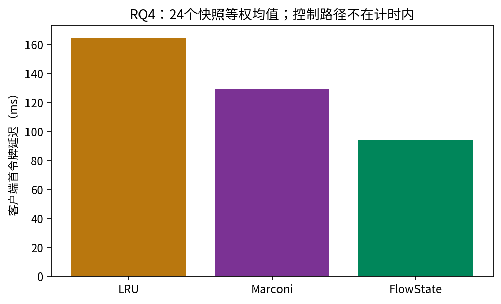

图无新误差棒：柱为24snapshot等权均值，置信区间属于配对差而非柱高。完整864条原始读数已摘录至tables/rq4_raw_requests.csv；每条来源是06_ttft/runs/{run_id}/pending_requests.jsonl。snapshot级与round级正式表位于analysis_snapshot_level/snapshot_level_metrics.csv和per_round_results.json。

FlowState对LRU 24胜0平0负，对Marconi22胜0平2负。两个负例的准确ID及差值保存在paired_ttft_results.json/rows中，完整列于下表。

| 对照 | 快照 | round | baseline−FlowState（ms） |
|---|---|---|---|
| Marconi | rq3-openhands-main-g184-round2 | 2 | -20.280136 |
| Marconi | rq3-openhands-main-g015-round5 | 5 | -11.360489 |
重复稳定性报告存在drift warning，CV中位约0.008588、P95约0.041852、max约0.298240；不能删除高变异样本后另报好看均值。

### 6.5 支持、不支持与失败边界

支持指定单卡串行单令牌协议的实际请求级改善。不能从此推出完整workflow、多令牌完成、吞吐、任意并发、强基线GPU优势或control-inclusive净收益。Recovery latency独立遥测在协议中标PARTIAL，TTFT不可被重命名成纯恢复kernel时间。

### 6.6 来源

06_ttft/frozen_protocol.json、run_plan与各runs/中的pending_requests.jsonl、selection.json、replay、correctness.json、result.json及日志；runtime_correctness.json；analysis_snapshot_level/{analysis_summary.json,paired_ttft_results.json,bootstrap_results.json,per_round_results.json,repetition_stability.json,gap_ttft_consistency.json}。脚本rq4_unified_runtime_harness.py、rq4_snapshot_level_analysis.py和sota_latency_runtime.py。完整历史命令若未在文件中留存则MISSING，实际入口与工作流依据源码标RECONSTRUCTED_FROM_CODE。

## 实验7：Control Overhead

### 7.1 问题与假设

把恢复之前的观察、状态构造、选择及协调真实计时，检验瓶颈是否来自optimizer还是同步控制通道，再验证批处理和传输优化。不同阶段的实验有不同批次、instrumentation和验证边界，不能把结果串成单次因果测量。

### 7.2 环境与各批次规模

| 批次 | 性质与规模 | 配置/对象 |
|---|---|---|
| RQ6 CPU决策 | 191快照、573条件×3=1719行 | 无GPU决策计时；正式Phi与optimizer |
| RQ6 fine-grained | 24快照×3=72新engine | Qwen单H100、25%预算、四pending |
| RQ6-D最终diagnostic | 3组×single/multiple=6 runs | C=8/12/20；每run20次no-op，总120 |
| RQ6-E batched | 同24快照×3=72独立runs | 批量读取与协调；重型统一验证另记 |
| 控制瓶颈profiling | 24快照×3=72独立runs | FlowState冻结旧E2E实现加计时包装 |
| optimized transport后的正式E2E | 24×3策略×3=216 | 与旧E2E同工作量，新实现新批次；详实验8 |

### 7.3 路径与实际执行过程

**Fine-grained，RECORDED：**worker建新engine、replay冻结snapshot、核对mapping与empty-state；在scheduler idle读取实际状态→construct→原optimizer→逐checkpoint recurrent-only reconciliation→驻留验证。T_total_control由连续路径直接计时，不是阶段均值相加；不含prefill/decode/recovery/正常请求TTFT。CPU-only部分重复冻结数据上的construction+allocation计时，runtime部分另外实际控制缓存。

**RQ6-D，RECORDED：**每组先20次no-op，再完整只读观测、全保留零驱逐验证及one/multiple驱逐；zero与one属于诊断条件，不是正式baseline。TCP→服务线程→scheduler队列→Event.wait→响应解码；记录提交入口、处理开始/结束和提交返回。显式GPU/NCCL synchronize为0不代表tensor.cpu/tolist没有隐式同步。诊断最终6runs与初步6runs/失败probe分开。

**Batch，RECORDED：**一次读取所有候选，一次按selected set协调；在批次内先校验view/mapping，再逐目标安全释放，最后返回证明。每epoch一次统一重型后验验证另记。不是删除correctness gate，不等于跨rank事务。

**Profiling与optimized transport，代码/记录结合：**公共观测1RPC、四pending frontier各1RPC、协调1RPC是旧E2E控制路径；每frontier查询前后各一次全树/allocator/semantic snapshot，四次查询共8份。优化将frontier合批，复用同epoch不可变候选token/handle metadata并减少重复验证与摘要；每个查询仍保留非干扰检查，状态变更后不可复用旧residency/view digest。代码入口control_path_profile.py、control_path_optimized_client.py、control_path_codec.py与tests/runtime/下的对应transport。真实执行记录在07_profile及08_optimized。无需重新设计allocation objective，不能省掉必要online信息。

### 7.4 直接数值

下表从两个72-run正式raw的timings_ns直接汇总；07_fine与07_batch是不同GPU批次，按相同快照匹配不等于同时配对执行。表中的中位数是run级描述统计。

| 批次 | 阶段 | 生命周期 | 均值（ms） | 中位数（ms） | 最大值（ms） |
|---|---|---|---|---|---|
| 07_fine | introspection | 72 | 1913.301282 | 1213.562999 | 14259.581384 |
| 07_fine | construction | 72 | 0.204297 | 0.208155 | 0.373182 |
| 07_fine | allocation | 72 | 0.747152 | 0.523442 | 1.805219 |
| 07_fine | reconciliation | 72 | 6483.255894 | 4118.309375 | 40922.380499 |
| 07_fine | total_control | 72 | 8398.846825 | 5617.014251 | 55185.557138 |
| 07_batch | introspection | 72 | 322.572724 | 55.494849 | 3380.404025 |
| 07_batch | construction | 72 | 0.169872 | 0.135060 | 0.333356 |
| 07_batch | allocation | 72 | 0.610429 | 0.591808 | 1.534885 |
| 07_batch | reconciliation | 72 | 304.785075 | 83.835756 | 4757.324708 |
| 07_batch | total_control | 72 | 629.826705 | 215.229416 | 6305.151674 |

Fine-grained完整控制均值8398.846825 ms、P50 5617.014251、P95 26811.051527、max55185.557138。四阶段和小于直接total的均值差1.338200 ms是阶段间控制逻辑。CPU直接决策均值0.313745 ms、P50 0.291330、P95 0.514072；CPU construction0.035797、allocation0.277133 ms，1719行不是1719独立workload。

Batch总控制均值629.827 ms、P50 215.229、P95 2708.593、max6305.152。旧报告同步RPC3708→144，平均51.5→2/epoch；**2只计一次批量读和一次协调，统一后验验证不在此RPC口径**。不能称系统端到端只需2次同步。

RQ6-D诊断的no-op mean39.908214、median30.031593、P95128.027844 ms；120次聚集于6engine。34次detach+free主机调用均值0.090111 ms，不包含未测的异步设备完成时间。多驱逐诊断RPC中处理函数外占87.7892%，不能套到原72-run的8.399秒上。相关性中C、驱逐数、RPC数共同变化，不能认定独立因果根因是GIL或某一变量。

| RQ6-D run | C | 驱逐N | introspection ms | 零驱逐含验证 ms | 干预含验证 ms |
|---|---:|---:|---:|---:|---:|
| g016_one | 8 | 1 | 168.020 | 216.343 | 284.166 |
| g016_multiple | 8 | 6 | 164.789 | 195.653 | 1672.388 |
| g005_one | 12 | 1 | 423.891 | 344.032 | 502.314 |
| g005_multiple | 12 | 9 | 340.265 | 472.501 | 2484.857 |
| g015_one | 20 | 1 | 2599.130 | 2606.830 | 2402.077 |
| g015_multiple | 20 | 16 | 2049.175 | 1903.203 | 14777.552 |

Profiling的72-run分解（每epoch累计，ms）：

| 阶段 | 总计 | 提交入口前 | 队列等待 | 服务端 | 事件交接 | 返回解码 | 客户端本地 |
|---|---:|---:|---:|---:|---:|---:|---:|
| common | 202.067 | 176.786 | 0.168 | 17.745 | 1.610 | 1.531 | 4.227 |
| policy | 299.434 | 203.944 | 0.247 | 9.890 | 73.754 | 4.557 | 7.043 |
| reconciliation | 213.673 | 165.752 | 0.082 | 39.550 | 0.527 | 2.994 | 4.768 |

这是新profiling批次，不是对旧293.093/211.337 ms的完整历史细分。独占/嵌套子步骤、P50/P95、调用数保存在07_profile/analysis/profile_summary.json与profiling_report.md；不得把嵌套时间重复相加。历史frontier无内部时间戳，完整细分为UNRESOLVED。

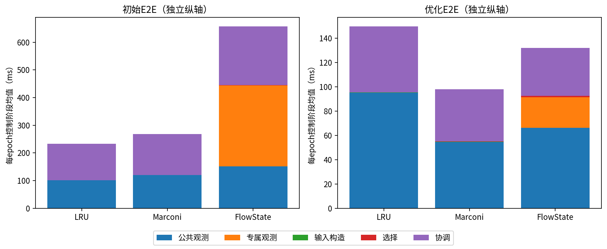

每面板是独立E2E批次，使用各自纵轴范围；柱表示五段控制均值，横轴三策略。小于1ms的construction/selection未被删掉。FlowState旧656.771、新131.904 ms；这只是控制均值并列，不把跨批次差值当净系统收益。

### 7.5 正确性、测试及失败

Fine-grained72/72门禁PASS；相关测试147 passed，full suite866 passed/2 skipped/2 warnings；早先两次suite因只读/输入环境失败，日志保留。RQ6-D最终6/6通过，初步runs和一次probe安装失败不混入最终；related55、full878的结果属于该历史批次。Batch72/72、H/E/G288/288通过，相关80、full888通过；前后selected set一致、FA保存、cleanup通过。所有测试数量是旧日志结果，本轮没有新运行。

控制时间右偏、重复波动与验证范围变化限制因果归因。free归还池内索引，不意味着驱动层GPU总显存立即下降。优化后的系统净收益必须看实验8，不能从该节控制下降推导。

### 7.6 来源

07_fine/{raw/per_epoch_overhead.jsonl,analysis/overhead_summary.json,analysis/scaling_summary.json,provenance/*,logs/*}；脚本rq6_system_overhead.py、rq6_runtime_overhead.py。07_diagnostic/final_diagnostic/runs/*、rpc_timings.json、diagnostic_summary.json；脚本rq6_bottleneck_diagnosis.py/analysis.py/report.py。07_batch/{raw/per_epoch_overhead.jsonl,analysis/aggregate_results.json,provenance/protocol.json,correctness/*,logs/rq6e_related_tests.log,full_cpu_suite.log}；脚本rq6_batched_control.py。07_profile及control_path_optimization_output/control_20260929/provenance保存诊断/优化来源，不拼成同批实验。

## 实验8：Control-inclusive Resume-Epoch E2E

### 8.1 问题与假设

测量从allocation boundary到四个当前pending请求执行结束的完整同步路径；检验请求侧恢复收益能否摊销真实控制与正式门禁开销。该名称不包括历史replay，也不是完整agent workflow或多令牌continuation。

### 8.2 环境与规模

两批分别为20260928初始、20260929优化。均Qwen3.5-9B、SGLang0.5.17、单H100、TP1、同24 policy-blind snapshots、25%逻辑预算，LRU/Marconi/FlowState各3独立重复，共216引擎/864单令牌请求，每run四请求串行。记录与protocol支持同输入，但批次时钟、排程抖动与控制实现不同。

### 8.3 执行与精确时间边界

**RECORDED+代码定义：**history replay完、pending就绪→t0；公共runtime state读取→FlowState专属frontier观察（不强加给其他策略）→policy input construction→真实本轮selection→和冻结selected reference核对→共用batched recurrent-only reconciliation与必要验证→control_end。不能直接把预冻结selected IDs当成本轮策略计算。随后四次串行submit/首token/流结束；c4为epoch_end。日志写盘、最终oracle重算、cleanup在外。

`evaluation/resume_epoch_e2e.py:73,99,164`及optimized对应函数定义：submit在generate调用前，first_token在首次非空output_ids，completion在迭代器耗尽后。原始时间戳以perf_counter_ns除1e6存为**毫秒**，只在同worker比较。

- epoch=c4−t0。
- mean barrier-to-completion=Σ(c_i−t0)/4，包含前序请求与request间同步。
- mean request execution=Σ(c_i−s_i)/4，为提交调用到流完成，含transport与runtime等待，非纯GPU。
- total control=control_end−t0，含参考集合核对等formal检查。
- residual=epoch−control−Σ(c_i−s_i)。这是算术余量，不是已准确拆分出的某一种开销。

optimized_e2e.py:203–217每请求前inspect_candidate_states，请求后metrics/H/E/G与census。首请求前检查、前三请求后的检查在epoch内；第四请求结束后的检查在c4外。同步探针、调度/dispatch等待无法按现有时钟独立归因，因此不能称余量全部属于production或全部可以安全删除。

### 8.4 两批完整结果与配对统计

| 批次 | 方法 | epoch（ms） | 平均屏障到完成 | 平均请求执行 | 总控制 | 剩余时间UNRESOLVED |
|---|---|---|---|---|---|---|
| 初始E2E | LRU | 2130.623197 | 1489.458306 | 163.374852 | 232.891939 | 1244.231850 |
| 初始E2E | Marconi | 1888.372043 | 1283.344778 | 128.156895 | 267.758168 | 1107.986294 |
| 初始E2E | FlowState | 2078.838022 | 1519.908850 | 92.536961 | 656.771203 | 1051.918977 |
| 优化E2E | LRU | 2952.253132 | 1899.797373 | 163.191318 | 149.455259 | 2150.032600 |
| 优化E2E | Marconi | 1875.991364 | 1259.646889 | 127.986886 | 97.957017 | 1266.086805 |
| 优化E2E | FlowState | 2425.640814 | 1498.532671 | 91.151943 | 131.904087 | 1929.128954 |

| 批次 | 对照 | 均值改善（ms） | 中位改善 | 95% CI | W/T/L |
|---|---|---|---|---|---|
| 初始E2E | LRU | 51.785175 | -234.470920 | [-226.75770578318176, 384.20600833826575] | 8/0/16 |
| 初始E2E | Marconi | -190.465979 | -137.575109 | [-384.9105204297437, 35.20921325816038] | 11/0/13 |
| 优化E2E | LRU | 526.612319 | 156.509596 | [-1057.4400107006231, 2214.9434228754703] | 15/0/9 |
| 优化E2E | Marconi | -549.649450 | -134.416075 | [-1784.9132109125455, 699.3964541832602] | 8/0/16 |

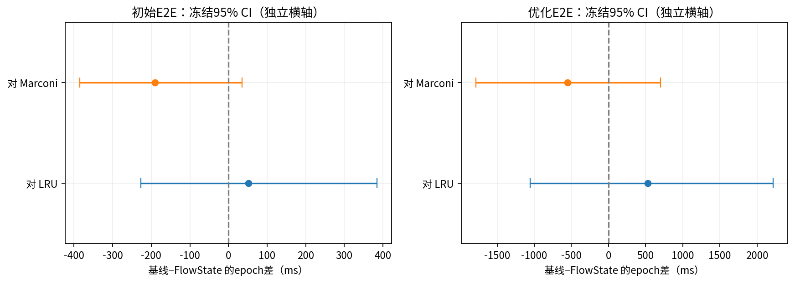

两面板各自使用不同横轴范围。横轴baseline−FlowState，正为FlowState更快，零线保留；误差线是正式round分层snapshot bootstrap 95% CI。本轮读取已有区间，不新增bootstrap。所有区间跨零，不支持稳定净收益。正确性PASS只是执行与门禁通过。

每个snapshot-policy先对3重复取均值，再24snapshot配对；不把864请求当独立单位。完整原始时间戳共两批1728条摘录至tables/e2e_raw_request_timestamps.csv；snapshot_means、rounds、cv_cases、cv_summary和break_even原样保存在tables/e2e_frozen_summaries.json。初始FlowState epoch CV中位0.45155、P95 0.67209；优化后中位约0.364、P95约1.280，保留所有不稳定重复，不做事后删点。

优化后FlowState请求均值91.152 ms低于RQ4 TTFT94.025 ms，并不违反完成晚于首token，因为不是同一批请求或同终点。不能把二者直接相减归因于优化。

#### 全部epoch负例与平局

| 批次 | 对照 | 快照 | round | baseline−FlowState（ms） |
|---|---|---|---|---|
| 初始E2E | LRU | rq3-openhands-main-g005-round3 | 3 | -229.941744 |
| 初始E2E | LRU | rq3-openhands-main-g015-round5 | 5 | -327.173703 |
| 初始E2E | LRU | rq3-openhands-main-g016-round2 | 2 | -276.549919 |
| 初始E2E | LRU | rq3-openhands-main-g037-round3 | 3 | -408.771050 |
| 初始E2E | LRU | rq3-openhands-main-g069-round3 | 3 | -403.673585 |
| 初始E2E | LRU | rq3-openhands-main-g070-round4 | 4 | -277.057543 |
| 初始E2E | LRU | rq3-openhands-main-g119-round5 | 5 | -906.518145 |
| 初始E2E | LRU | rq3-openhands-main-g122-round4 | 4 | -472.949570 |
| 初始E2E | LRU | rq3-openhands-main-g156-round2 | 2 | -248.043102 |
| 初始E2E | LRU | rq3-openhands-main-g157-round3 | 3 | -197.862521 |
| 初始E2E | LRU | rq3-openhands-main-g167-round5 | 5 | -239.000096 |
| 初始E2E | LRU | rq3-openhands-main-g171-round5 | 5 | -1217.380201 |
| 初始E2E | LRU | rq3-openhands-main-g172-round2 | 2 | -228.229100 |
| 初始E2E | LRU | rq3-openhands-main-g176-round2 | 2 | -599.263083 |
| 初始E2E | LRU | rq3-openhands-main-g177-round3 | 3 | -275.372526 |
| 初始E2E | LRU | rq3-openhands-main-g184-round2 | 2 | -36.910800 |
| 初始E2E | Marconi | rq3-openhands-main-g005-round3 | 3 | -407.274192 |
| 初始E2E | Marconi | rq3-openhands-main-g015-round5 | 5 | -1636.106481 |
| 初始E2E | Marconi | rq3-openhands-main-g037-round3 | 3 | -140.572965 |
| 初始E2E | Marconi | rq3-openhands-main-g050-round4 | 4 | -134.577253 |
| 初始E2E | Marconi | rq3-openhands-main-g069-round3 | 3 | -692.375570 |
| 初始E2E | Marconi | rq3-openhands-main-g070-round4 | 4 | -237.809302 |
| 初始E2E | Marconi | rq3-openhands-main-g119-round5 | 5 | -322.068213 |
| 初始E2E | Marconi | rq3-openhands-main-g157-round3 | 3 | -492.312293 |
| 初始E2E | Marconi | rq3-openhands-main-g167-round5 | 5 | -1435.633023 |
| 初始E2E | Marconi | rq3-openhands-main-g171-round5 | 5 | -990.122969 |
| 初始E2E | Marconi | rq3-openhands-main-g172-round2 | 2 | -146.290191 |
| 初始E2E | Marconi | rq3-openhands-main-g176-round2 | 2 | -621.192730 |
| 初始E2E | Marconi | rq3-openhands-main-g199-round5 | 5 | -1066.704590 |
| 优化E2E | LRU | rq3-openhands-main-g005-round3 | 3 | -33.324824 |
| 优化E2E | LRU | rq3-openhands-main-g037-round3 | 3 | -250.804585 |
| 优化E2E | LRU | rq3-openhands-main-g050-round4 | 4 | -7572.864465 |
| 优化E2E | LRU | rq3-openhands-main-g094-round4 | 4 | -180.907540 |
| 优化E2E | LRU | rq3-openhands-main-g119-round5 | 5 | -366.617255 |
| 优化E2E | LRU | rq3-openhands-main-g122-round4 | 4 | -10429.841897 |
| 优化E2E | LRU | rq3-openhands-main-g167-round5 | 5 | -2685.173044 |
| 优化E2E | LRU | rq3-openhands-main-g177-round3 | 3 | -873.321444 |
| 优化E2E | LRU | rq3-openhands-main-g184-round2 | 2 | -24.129931 |
| 优化E2E | Marconi | rq3-openhands-main-g015-round5 | 5 | -1482.984225 |
| 优化E2E | Marconi | rq3-openhands-main-g016-round2 | 2 | -322.930772 |
| 优化E2E | Marconi | rq3-openhands-main-g037-round3 | 3 | -310.909065 |
| 优化E2E | Marconi | rq3-openhands-main-g050-round4 | 4 | -7652.516573 |
| 优化E2E | Marconi | rq3-openhands-main-g058-round4 | 4 | -289.442209 |
| 优化E2E | Marconi | rq3-openhands-main-g094-round4 | 4 | -45.798076 |
| 优化E2E | Marconi | rq3-openhands-main-g112-round2 | 2 | -53.971818 |
| 优化E2E | Marconi | rq3-openhands-main-g119-round5 | 5 | -459.816659 |
| 优化E2E | Marconi | rq3-openhands-main-g122-round4 | 4 | -10561.947985 |
| 优化E2E | Marconi | rq3-openhands-main-g156-round2 | 2 | -214.860333 |
| 优化E2E | Marconi | rq3-openhands-main-g167-round5 | 5 | -2744.549370 |
| 优化E2E | Marconi | rq3-openhands-main-g171-round5 | 5 | -15.143476 |
| 优化E2E | Marconi | rq3-openhands-main-g172-round2 | 2 | -420.912243 |
| 优化E2E | Marconi | rq3-openhands-main-g177-round3 | 3 | -561.366831 |
| 优化E2E | Marconi | rq3-openhands-main-g184-round2 | 2 | -464.292247 |
| 优化E2E | Marconi | rq3-openhands-main-g199-round5 | 5 | -26.212225 |

表是冻结non_winning_cases，不挑代表负例；两批epoch对照均无ties。正例仍全部保留在冻结paired/cases；没有只筛输赢统计。

### 8.5 未通过正式门禁的E2E及支持边界

Serving-path目录08_serving状态BLOCKED_BY_CORRECTNESS_GATE，正式生命周期0/216、请求0/864。没有可执行serving runner的正式GPU结果；时延、CI、W/T/L均UNKNOWN而不是0。

资格检查证明，仅观察epoch末态会漏掉中途recurrent丢失、换槽后恢复；原生MAMBA eviction队列又没有完整覆盖相应事件。所以不能把逐请求census删掉后声称等价正确性。该失败是CPU证据资格阻塞，不是FlowState在GPU上发生错误或运行速度失败。probe-inclusive两批已测数据保留，不能扣掉估计probe成本生成新serving结果。

支持当前含探针协议下准确的整epoch测量、请求优势与控制成本事实。不支持正常生产serving净收益、多token完成、并发吞吐、跨架构端到端有效性。break-even只是基于本批控制/请求均值的外推，不是改变请求数量后的实测；正式summary已有则归档，不用旧RQ4/RQ6拼接。

### 8.6 来源

08_initial与08_optimized的plan.json/protocol.json、runs/*/{record.json,evidence.json}、analysis/{summary.json,final_report.md}及cleanup/manifest记录。脚本resume_epoch_e2e.py、resume_epoch_e2e_analysis.py、control_path_optimized_e2e.py、control_path_optimization_analysis.py。08_serving/{final_report.md,gate_qualification.json,completion.json,integrity_summary.json}以及serving_path_gate_qualification.py；测量范围还见07_profile/analysis/measurement_scope.md。原始文件存在性与读取范围在索引中区分。

## 实验9：辅助实验、容量与可行性审查

### 9.1 问题与分类

本节防止把环境资格、受控例子、CPU设计审查或失败前置gate误当主性能实验。对象包含physical state payload、headroom、Kimi gates、早期受控工作负载，以及P2/P3原生事件/物理预算可行性。

### 9.2 环境与数据规模

| 项目 | 实际性质 | 规模与状态 |
|---|---|---|
| checkpoint size WP1 | runtime allocation阶段只读tensor probe | Qwen TP1，server启动含一次内置80-token warmup；非latency实验 |
| OpenHands occupancy | 单卡状态/容量校准 | 4 workflows×5 turns=20请求，21 census，PASS |
| boundary value WP3 | 受控工作流观察 | 原findings/analysis及图归档，非主总体采样 |
| Kimi Phase1 | TP2 runtime组件资格 | smoke+3独立生命周期，READY |
| Kimi Phase2 | 同optimizer接口与TP2批量实现资格 | 4候选、K2、smoke+3生命周期，READY |
| P2 | 原始数据/结构CPU审计 | NOT_FEASIBLE_FROM_EXISTING_DATA |
| P3-G0 | 源码与接口设计审查 | PARTIAL_RUNTIME_OR_AGENT_GAP |
| P3-G1 | 物理容量合同审查、CPU算账 | RESOURCE_CONTRACT_NEEDS_EXTENSION |
| KVFlow受控对照 | CPU设计实例 | 3 pending、K1；不进入573正式总体 |

### 9.3 实际过程与配置

**WP1，报告记录、原启动日志MISSING：**原报告描述cache allocation打印实际tensor shape/dtype，但所列server_probe.log在当前目录未找到，不把原报告的行号冒称为本轮直接读到的日志。另有既有state fingerprint原始JSON交叉支持payload：`/home/wjg/code/newfind/artifacts/exp2-b-PASS-20260812T130323Z/strict_L2048.json:2023`，本轮实际读取的components/hashed_bytes分别如下。普通non-int8 recurrent完整slot=conv BF16 1,179,648 bytes + temporal FP32 50,331,648 bytes =51,511,296 bytes=49.125MiB。working、tracking/temporary、checkpoint是相同布局的不同ownership角色，不是固定四份副本。`4 state slots per request`是容量规划口径；free slot不等于释放预分配HBM。原报告引用server_probe.log:664–668、:11、:677；这些缺失日志行本轮无法直接复核。fingerprint原始JSON的temporal/conv/总bytes可直接核对，二者证据强度不同。

**Occupancy，RECORDED：**四条真实OpenHands历史串行执行20请求，不执行policy或主动FlowState eviction；pool28、context131200；检查多workflow同时物理驻留及全过程census。峰值20 resident recurrent slots，最低8 free，native eviction=0、FA cascade=0、headroom SUFFICIENT。G可非零，all_gaps_zero=false并不自动表示容量失败，需按实际边界解释；原summary保留g_min0/g_max2437。

**Kimi Phase1，RECORDED：**模型索引及20权重分片的映射/长度核查，不是全部权重内容hash。Triton后端、extra_buffer、track256、32K、无overlap/CUDA graph、HiCache/PD/投机解码关闭。8K/16K KDA真实物化，两个rank独立证明MLA到16K。只驱逐目标c2，检查FULL全树/allocator及非目标c1不变，各次两卡回到14MiB、无compute进程。Phase1报告的H/E/G以其当时观测路径为准；Phase3真实请求发现并清理10/12/14K中间KDA的事实不能被省略。

**Kimi Phase2，RECORDED：**两个workflow各2K/4K checkpoint，A1/A2/B1/B2，K2。一次逻辑批量读取、一次逻辑批量协调，各向TP0/TP1发送一份完整消息，总4 rank RPC；调度器全空闲、期间无generate，rank内返回postvalidation。S*={A2,B2}；不是跨rank事务/rollback。非候选已物化分叉末端保持不变。

**P2/P3，DESIGN_ONLY或CPU_AUDIT：**P2只审查原393条AgentX traces、98827 invocation、1697 subagent容器及已有23回放快照。发现无原生fork/ready/state generation关联；API区间重叠不能替代pending。P3-G0找到可复用Tree-of-Thought/StreamExecutor代码，但AgentX collector实际串行；缺ready/admission gate、稳定rid联接、联合capture与slot generation事件。P3-G1区分pool N、长期retention K、执行/瞬态预留及可撤销借用，当前实现没有独立长期quota强制。全部未执行Pilot。

### 9.4 结果与图表

Kimi Phase1 smoke+3/3通过；Phase2 smoke+3/3通过、相关测试62 passed。Phase2空集模型成本461.528689040、S*152.830777808、全候选0，这些沿用Qwen冻结Phi，仅证明接口与集合构建，**不是Kimi实测或Kimi校准预测**。Phase3性能见实验2，相关测试46 passed与5267既有文件未变属于旧记录，不是本轮新测试。

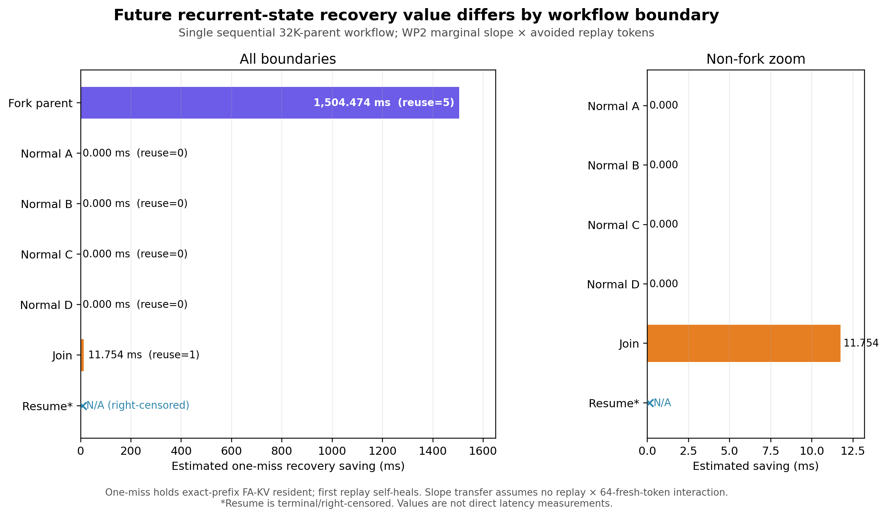

图来自09_boundary原始受控工作流；必须注意纵轴是由WP2斜率和机械fallback长度估计的恢复价值，不是每个边界的实测时延。真实观测为Parent被选择5次、四个NORMAL各0次、Join被选择1次；估计分别1504.474、0、11.754 ms。终点Resume右删失，价值为N/A，不能画为低价值负例。与正式OpenHands/AgentX矩阵不同，不能用图证明一般branch-state merge。Join序列化分支输出不等于合并两份recurrent tensor。

P2：69条件K<K_min为0，缺原生事件和有效竞争；P3-G0与G1只证明有技术路径/有限接口缺口，不证明真实竞争已发生。G1示例N28、两pending的保守执行预留8、K20是合同设计，未实现长期enforcement，更不会在两pending下使K<K_min；不能记为GPU实验参数或成功竞争结果。

KVFlow受控CPU例：STE1/3/5，K1，KVFlow Adaptation选CP_NEAR，modeled C=2218.544191 ms；Marconi/FlowState/Exact选CP_FAR，C=968.602712 ms。它只比较显式workflow距离信号，不是完整KVFlow系统，也不是新真实workload证据。

### 9.5 支持与不支持

尺寸与occupancy给实际空间/角色依据，不能把逻辑K改称长期物理quota；Kimi gates支持限定空闲TP2下组件控制与接口迁移，不能证明跨rank原子/失败恢复。P2/P3结论限制当前可用证据，不提供性能曲线。设计状态和预想可行性始终与GPU PASS分开。

### 9.6 来源与其他发现

09_size/{server_probe.log,runtime_tensor_probe.patch,findings.md}；09_capacity/{config.json,summary.json,census.jsonl,requests.jsonl,stdout.log,stderr.log}；09_kimi1/09_kimi2/09_kimifreeze的runs、per_rank_state、correctness、logs及manifest；09_p2/09_p3g0/09_p3g1全部审查报告；09_kvflow的per_case/结果与final_report。原文件完整路径见索引。

### 9.7 早期正式结果与版本迁移（独立归档）

**Recovery Profiler v2：**固定32K FA前沿、客户端TTFT，5个calibration gaps=0/4K/8K/16K/32K，4个held-out gaps=2K/6K/12K/24K；每条件2warmup+12measured，126记录PASS、gap_mismatch0。旧Phi MAE12.9101/MAPE2.2473%，Linear v2为16.2612/6.2136%，Monotone piecewise v2为12.0755/3.9979%。原结果best_held_out_model为piecewise，但不是所有指标都优于旧Phi；不替换实验3的正式位置模型。raw_samples.jsonl、run_metadata.json、validation_summary.csv与model_comparison.json保留。

**Step9B旧受控H100 latency：**69等价类，2warmup+10measured，共828raw（138预热、690测量），Qwen、单H100、客户端流式TTFT；按class_multiplicity恢复逻辑workload权重，不能把weighted_request_count当独立执行次数。其FlowState选择曾使用旧模型；formal_model_regression证实N16/K4和signal/K8选择改变，旧latency不能支持最终模型的同组比较。N16/K12与signal/K4集合IDENTICAL可保持其有限复用范围。

**正式模型定向重跑：**独立新批次33等价类、66预热、330测量；仅N16/K4与signal/K8。三基线选择继承旧manifest，FlowState用新模型选择，但四方法latency都在此次同源重跑测量。flush、rebuild、reconcile不计TTFT；加权结果如下，不混入RQ4的24快照。

| 受控场景 | K | 方法 | 真实测量次数 | 逻辑加权请求数 | TTFT加权均值（ms） | 加权中位数 | 加权P95 |
|---|---|---|---|---|---|---|---|
| scalable_multiworkflow_v2_n16 | 4 | FlowState | 60 | 600.0 | 240.32868324999998 | 168.392239 | 659.997804 |
| scalable_multiworkflow_v2_n16 | 4 | Global-LRU | 50 | 600.0 | 309.0959380383334 | 322.679682 | 664.467982 |
| scalable_multiworkflow_v2_n16 | 4 | KVFlow-style | 50 | 600.0 | 309.66708339333337 | 322.43703 | 667.28192 |
| scalable_multiworkflow_v2_n16 | 4 | Marconi-style | 50 | 600.0 | 310.37549613833335 | 322.042259 | 667.842759 |
| sota_signal_stress_v1 | 8 | FlowState | 20 | 400.0 | 183.8651185 | 41.263091 | 333.904805 |
| sota_signal_stress_v1 | 8 | Global-LRU | 40 | 400.0 | 467.25813374999996 | 41.128092 | 1465.842317 |
| sota_signal_stress_v1 | 8 | KVFlow-style | 40 | 400.0 | 467.212228675 | 41.290009 | 1466.535966 |
| sota_signal_stress_v1 | 8 | Marconi-style | 20 | 400.0 | 185.04462854999997 | 42.692755 | 334.539814 |

**TraceLab正式离线比较：**105个冻结C128且X≥2逻辑快照，37个X≥4次级切片，CPU-only；四预算25/50/75/100%，四方法，snapshot等权，262 pending总计。来源DuckDB及原protocol的结构覆盖分层，不是自然频率抽样。没有显式LLM DAG、原始token IDs或真实runtime residency，故作为独立逻辑研究结果，而非新增真实共享GPU cohort。

| 预算 | 方法 | snapshot数 | mean modeled ms | median modeled ms | pending EHR |
|---|---|---|---|---|---|
| 0.25 | Global-LRU | 105 | 4099.607753060427 | 3701.744536924302 | 0.3969465648854962 |
| 0.25 | KVFlow-style | 105 | 4091.1034729690364 | 3701.744536924302 | 0.40076335877862596 |
| 0.25 | Marconi-style | 105 | 4580.144787390863 | 4062.511016423913 | 0.11068702290076336 |
| 0.25 | FlowState | 105 | 2940.443447662324 | 2160.748608979885 | 0.40076335877862596 |
| 0.5 | Global-LRU | 105 | 3689.894451981067 | 3511.835096754947 | 0.4732824427480916 |
| 0.5 | KVFlow-style | 105 | 3681.3901718896764 | 3511.835096754947 | 0.4770992366412214 |
| 0.5 | Marconi-style | 105 | 4266.521399694529 | 3900.859031607715 | 0.12213740458015267 |
| 0.5 | FlowState | 105 | 2540.2510309193694 | 1933.7833468794875 | 0.48091603053435117 |
| 0.75 | Global-LRU | 105 | 3383.440345020345 | 3335.7167857064796 | 0.5305343511450382 |
| 0.75 | KVFlow-style | 105 | 3334.5389913343674 | 3298.895441814761 | 0.5419847328244275 |
| 0.75 | Marconi-style | 105 | 3883.573950510064 | 3575.716538018838 | 0.14885496183206107 |
| 0.75 | FlowState | 105 | 2143.8017249575682 | 1521.3069642165854 | 0.5648854961832062 |
| 1.0 | Global-LRU | 105 | 1972.5747953186471 | 1128.656321302119 | 0.7442748091603053 |
| 1.0 | KVFlow-style | 105 | 1723.8625580874918 | 893.9809483966076 | 0.7709923664122137 |
| 1.0 | Marconi-style | 105 | 2701.8507646671906 | 2176.173111347278 | 0.3511450381679389 |
| 1.0 | FlowState | 105 | 0.0 | 0.0 | 1.0 |

TraceLab的EHR分母是pending，不是snapshot Full Coverage；100%预算相对于X而非全部候选checkpoint数，不能套到当前|C|预算。所有这些早期结果的原始CSV完整归档在tables中，见09_legacy、09_rerun、09_v2、09_tracelab与09_regression路径；controlled_multiworkflow_v1、scalable_multiworkflow_v2、sota_signal_stress_v1是受控输入来源，非真实主总体。未逐条重审所有早期日志，源数据的存在性与逐行语义确认在索引中分开。

## 附录：完整性、复现范围与未解决证据

全部图表来源见figures/figure_sources.csv。P4-G1三张图及矩阵逐字节复用；WP2/WP3原图归档；Kimi配对、模型留出、RQ4均值及E2E图只从对应冻结值CPU重绘。脚本assemble_evidence.py不导入FlowState、SGLang或实验模块，不重跑baseline。

本轮生成器核对：20校准点、210heldout raw行、12误差点；M0/M1/M2 MAE/MAPE与冻结metrics一致；RQ4原始864请求；两批E2E各216records、864请求，时延均值与冻结summary一致；已读取源文件前后hash一致。文件存在性、图表视觉核对与逐行日志语义核验不是同一件事。

原命令文件可用时转录historical_commands.md；没有命令记录的脚本只提供入口路径而非凭空补完整launch参数。完整shell历史、未保存的绝对TTFT时间戳、pure kernel/restore独立分解、production residual细分、原生AgentX fork/ready、跨rank事务、未执行serving/Pilot均见missing_evidence.md。缺失值从不画成0。
