# 实验图表浏览

原图归档或冻结数据CPU重绘；数据、计时口径与限制见实验手册，具体来源见figure_sources.csv。

## 总体分配质量（modeled ms）

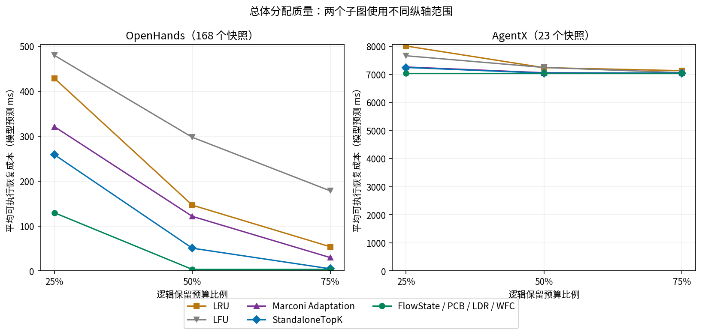

[PDF](overall_allocation_quality.pdf)

## 强基线最终结果全平

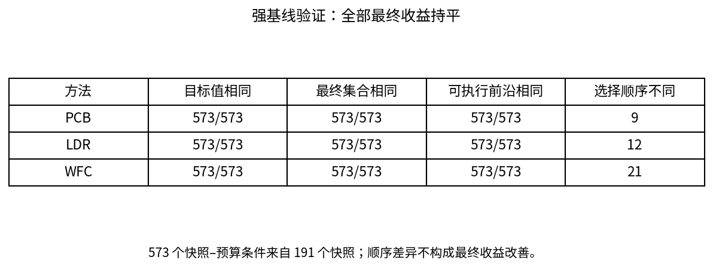

[PDF](strong_baseline_validation.pdf)

## 逻辑预算与共享结构

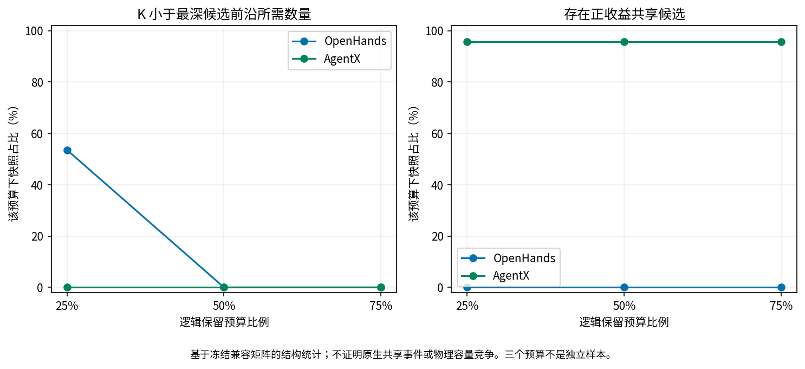

[PDF](budget_workload_discriminativeness.pdf)

## Qwen固定32K恢复实测

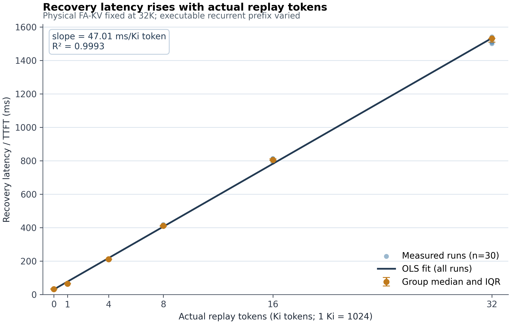

[PDF](plot_replay_latency.pdf)

## 直接驱逐局部因果验证

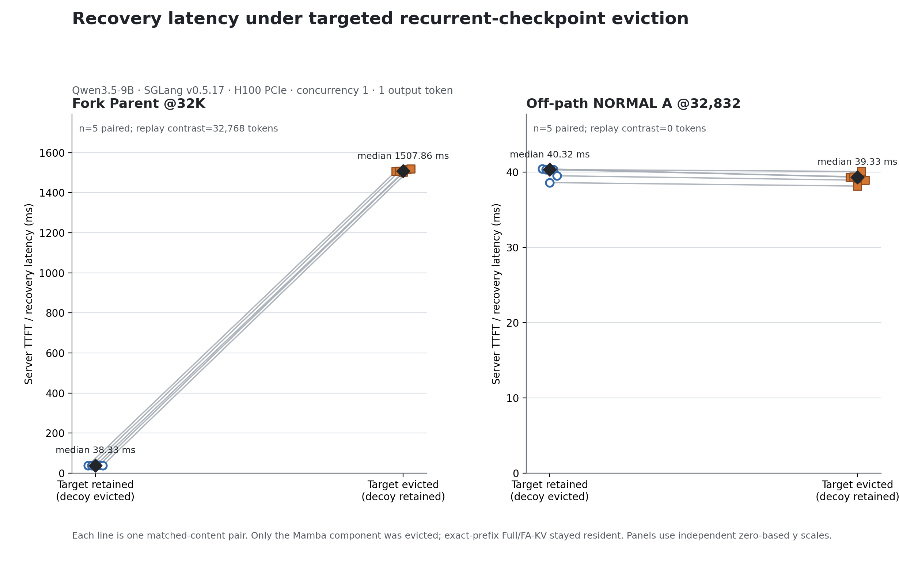

[PDF](plot_fork_eviction_latency.pdf)

## 边界价值估计（不是各边界时延实测）

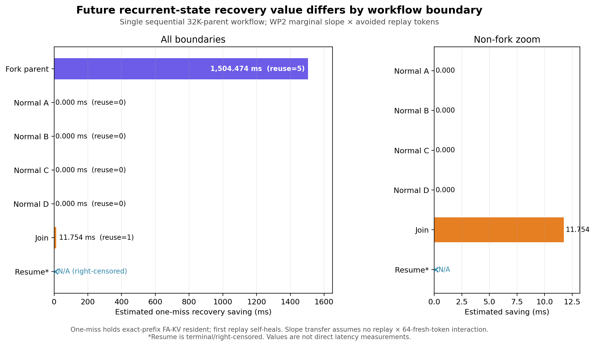

[PDF](plot_boundary_value.pdf)

## Kimi五次恢复配对

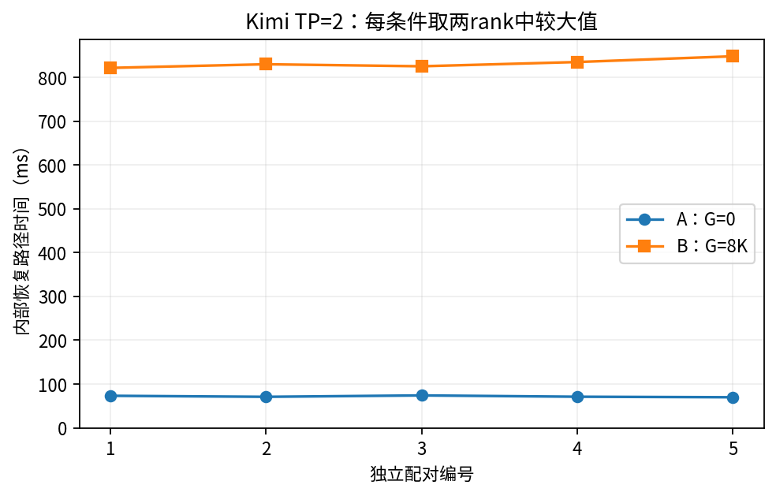

[PDF](kimi_recovery_pairs.pdf)

## 正式模型留出预测与误差

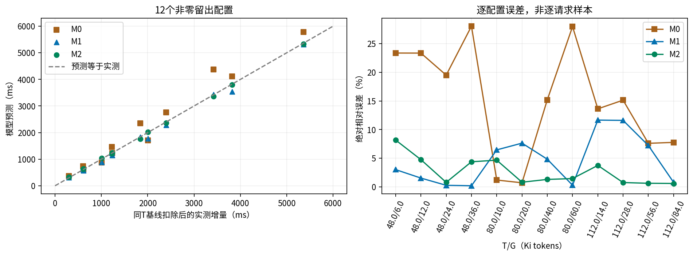

[PDF](cost_model_heldout.pdf)

## RQ4请求级TTFT

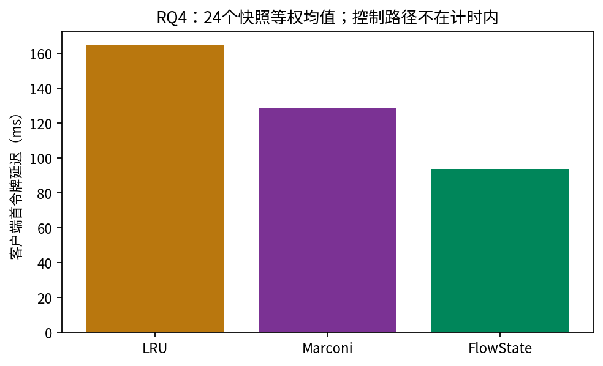

[PDF](rq4_ttft.pdf)

## 两批E2E配对区间

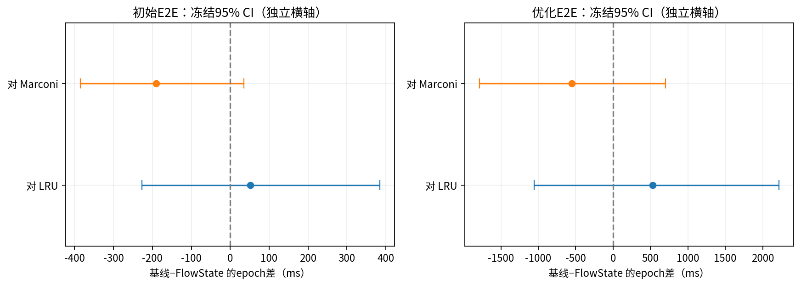

[PDF](e2e_paired_intervals.pdf)

## 两批E2E控制阶段

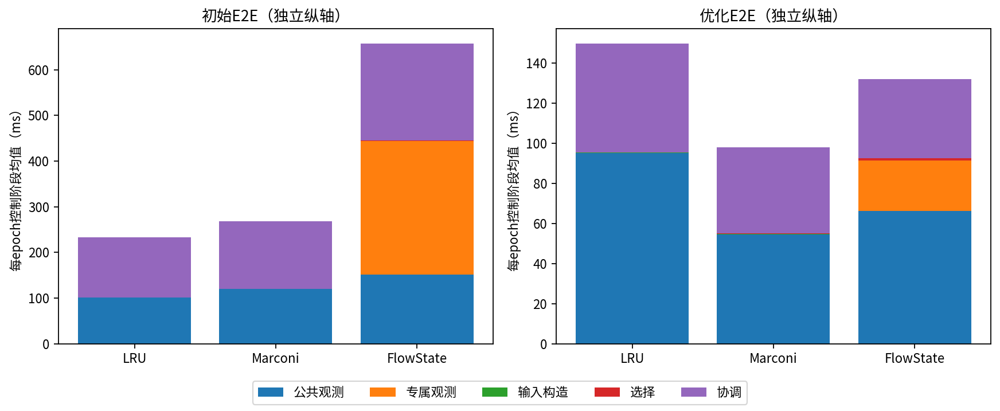

[PDF](e2e_control_stages.pdf)
